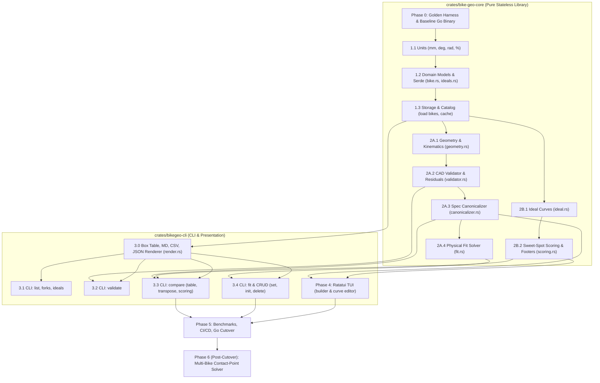

# Rust Migration Plan & Architectural Strategy: Principled & Bug-Compatible Port

This document outlines the evaluation, architecture, and step-by-step strategy for migrating **BikeGeo** from Go to **Rust**. The overriding mandate is **strict behavioral and numerical bug-compatibility**, validated by differential testing (diffing CLI outputs, JSON payloads, and exit codes against the reference Go binary).

---

## 1. Strategic Context & AI-Assisted Migration Tradeoffs

Porting an AI-generated Go CLI/TUI focused on bicycle geometry and kinematics to Rust via AI is a classic tradeoff between **stronger compile-time domain modeling** and **increased generation friction**.

Because you are not typing the code yourself, the evaluation shifts away from human ergonomics and toward **how effectively an LLM collaborates with each compiler**.

### 1.1 Why It’s a Good Idea (The Pros)

#### 1. The Compiler as an AI Guardrail
LLMs frequently make subtle semantic errors in geometric math—like adding a frame's *Reach* (a horizontal vector) directly to a *Stem Length* without accounting for the head tube angle, or mixing up degrees and radians.
* **In Go:** If both values are `float64`, the code compiles cleanly and silently outputs bad fit numbers. While you can define custom types in Go (`type Millimeters float64`), Go's lack of operator overloading makes doing trigonometry on custom types painfully verbose, so AI almost always defaults to raw `float64` primitives.
* **In Rust:** You can instruct the AI to use the **newtype pattern** or crates like `uom` (Units of Measurement) alongside operator overloading (`std::ops::Add`, etc.). If the AI tries to add `Stack` (vertical) to `Reach` (horizontal), or pass `Degrees` into a `sin()` function expecting `Radians`, `rustc` rejects it at compile time.

#### 2. Algebraic Data Types for Bike Components
Bicycle components are full of mutually exclusive states and conditional geometry:
* A fork is either **Rigid** (static axle-to-crown) or **Suspension** (dynamic axle-to-crown based on travel and sag percentage).
* A handlebar has either **Flat Bar** geometry (backsweep, upsweep, rise) or **Drop Bar** geometry (reach, drop, flare).
* A seatpost is either **Rigid**, **Suspension** (axial travel vs. vertical travel), or a **Dropper**.

In Go, AI typically models these using flat structs with unused zero-value fields or clumsy `interface{}` patterns, making it easy for the AI to forget to apply sag in a downstream calculation. In Rust, `enum` variants with embedded data force exhaustive `match` statements. If you add a new component archetype later, the Rust compiler forces the AI to update every single geometric calculation across the codebase.

#### 3. Value Semantics and Transformation Pipelines
Computing a rider's contact points (bottom bracket to saddle, bottom bracket to grips) is fundamentally a chain of 2D affine transformations (rotations and translations). Rust’s trait system and operator overloading allow libraries like `nalgebra` or `glam` to express vector and matrix math cleanly (`p1 + v1.rotate(angle)`), whereas Go's lack of operator overloading forces nested method chains or verbose helper functions that are harder to audit visually.

### 1.2 Why It’s a Terrible Idea (The Cons)

#### 1. The TUI Architecture Trap (Borrow Checker Friction)
While AI writes pure mathematical functions in Rust effortlessly, **AI struggles significantly more with stateful Rust TUIs (`ratatui`) than Go TUIs (`bubbletea`)**.
* `bubbletea` uses the Elm Architecture where state is mutated and returned inside a garbage-collected runtime. LLMs rarely fail to compile `bubbletea` code on the first pass.
* In `ratatui`, managing cross-pane state (e.g., selecting two frames from a database list, holding mutable references to slider adjustments for stem length/spacers, and rendering a comparison table simultaneously) frequently trips up the AI on lifetimes, borrowing rules, and `RefCell`/`Rc` patterns. You will spend noticeably more tokens and iterations pasting compiler errors back to the AI for UI plumbing.

#### 2. Performance Is Completely Irrelevant Here
Trig calculations and 2D matrix transforms for 50 bike frames take microseconds in both languages. A CLI/TUI waiting on human keystrokes will see **zero perceptible difference** in execution speed, startup time, or memory footprint between Go and Rust. Any argument for porting based on runtime speed or garbage collection pauses does not apply to this domain.

#### 3. Translation Drift and Regression Risk
If your Go program currently works and its geometric formulas are verified, asking an LLM to port it introduces translation risk. LLMs translating large blocks of math can accidentally flip a sign (e.g., treating seat tube angle setback vs. head tube angle offset inconsistently) or subtly alter floating-point rounding behavior in table displays. Without a comprehensive test suite of known inputs and outputs, you risk breaking working math.

### 1.3 Go vs. Rust for AI-Driven Geometry Code

| Dimension | Go (Current) | Rust (Proposed Port) |
| :--- | :--- | :--- |
| **AI First-Pass Compile Rate** | **Very High** — Simple syntax and GC mean the AI rarely gets stuck in compiler loops. | **Moderate** — Pure math compiles easily; complex TUI state management often triggers borrow-checker loops. |
| **Domain Type Safety** | **Low/Medium** — AI defaults to `float64` to avoid verbose type conversions; unit errors slip through. | **Very High** — Zero-cost newtypes, enums, and operator overloading catch semantic bugs at compile time. |
| **TUI Ecosystem** | `bubbletea` + `lipgloss` — Extremely clean for AI to generate and extend. | `ratatui` — Powerful layout engine and canvas widgets, but steeper ownership constraints for AI. |
| **Vector/Geometry Math** | Verbose (`v1.Add(v2.Scale(x))`). | Expressive (`v1 + v2 * x`) via `glam` or `nalgebra`. |
| **Compilation Feedback Speed** | **Instant** (< 1s incremental builds). | **Slow** (2–10s incremental builds), slowing down automated AI agent verification loops. |

### 1.4 Will It Pay Off?

#### Short Term: **No (Net Loss)**
In the short term, a port is pure overhead. You will spend time and tokens fighting `ratatui` ownership issues, rebuilding CLI flag parsing (`clap`), re-implementing serialization (`serde`), and verifying that the AI didn't hallucinate a sign flip in your stack/reach/setback equations. If the project is mostly "done" and you just use it as a personal utility, porting it will not pay off.

#### Long Term: **Conditional Yes**
It will pay off over the long term **only if** both of the following are true:
1. **You plan to significantly expand the semantic complexity of the domain model.** For example, adding full kinematic solver loops (calculating exact hip/knee/shoulder angles from limb lengths), dynamic sag curves, tire pressure / rolling radius deformations, or **multi-bike contact-point solver algorithms** (see Section 6, Phase 6). As the domain model grows, an AI modifying a Go codebase is much more likely to introduce silent regressions or invalid state combinations than an AI constrained by a strict Rust type system.
2. **You force the AI to actually use Rust's type system.** If you let the AI do a naive, 1-to-1 line translation from Go to Rust—where every struct field is still a raw `f64` and components are bags of `Option<f64>`—you get all the pain of Rust's borrow checker with **none** of its semantic benefits.

### 1.5 The AI Collaboration Execution Blueprint

To neutralize the cons and maximize the pros when porting via AI:

1. **Export Golden Tests First:** Have the AI generate a JSON/TOML test suite from your Go program containing 20+ bike setups and their exact computed outputs (handlebar X/Y, saddle X/Y, effective top tube, cockpit distance, etc.).
2. **Design the Types First:** Instruct the AI to design the Rust domain model (`Millimeter`, `Degree`, `Radian`, `Point2D`, `Vector2D`, and strict `enum` hierarchies for parts) before writing any math or UI code.
3. **Strictly Separate Core from TUI:** Put all geometry math in a pure, stateless library crate (`crates/bike-geo-core`) validated against the golden JSON tests, and keep the `ratatui` / `clap` binary in a thin wrapper crate (`crates/bikegeo-cli`) so UI borrow-checker churn never touches your math.

---

## 2. Guiding Principles & Objectives

1. **Strict Output Parity (Zero Diff Tolerance):**
   - The Rust binary must accept identical CLI flags and arguments, produce identical standard output (table, markdown, CSV, and JSON), output identical diagnostic/residual messages, and return identical exit codes (`0` on success, `1` on domain/validation failure, `2` on CLI usage/parse error).
2. **Ground Truth & Chart Immutability:**
   - Published manufacturer geometry numbers remain sacred. No tolerances, rounding residuals, or validation thresholds (`2.0 mm` precision floor, `1.0 mm` A2C slop trigger) may be nudged during the port.
3. **Type-Driven Domain Safety:**
   - Eliminate Go's primitive obsession and untyped structs by encoding physical invariants into Rust's type system:
     - Compile-time units of measure (`Millimeter`, `Degree`, `Radian`, `Percent`).
     - Exhaustive algebraic data types (sum types) for fork configurations (`Rigid` vs. `Suspension`) and headset cups (`Integrated` vs. `External`).
     - Make invalid states unrepresentable (e.g., non-zero sag on a rigid fork cannot compile).
4. **Decoupled Architecture (`Core` vs. `Presentation`):**
   - Isolate all physics, geometry, scoring, and storage in a standalone, stateless library crate (`crates/bike-geo-core`).
   - Keep CLI flag parsing, table printing, and TUI view state in `crates/bikegeo-cli` to prevent UI lifetime complexities from leaking into kinematic calculations.
5. **Differential Test-Driven Verification:**
   - No Go package is deprecated until its Rust equivalent passes all ported unit tests and the full differential CLI test harness with zero diff.

---

## 3. Workspace Architecture & Dependency Critical Path (DAG)

The Rust project is structured as a Cargo workspace separating the stateless core from the presentation layer:

```text
bikegeo/
├── Cargo.toml                  # Workspace root
├── crates/
│   ├── bike-geo-core/          # Pure, stateless mathematical domain library
│   │   ├── src/
│   │   │   ├── units.rs        # Dimensional newtypes & arithmetic operator overloads
│   │   │   ├── model/          # Bike, Fork, Headset, Size Serde schemas
│   │   │   ├── storage/        # JSON bike loading & persistence
│   │   │   ├── catalog/        # In-memory frame registry & indexing
│   │   │   ├── geometry/       # Kinematics, sag trig, 2D affine transforms
│   │   │   ├── validator/      # CAD validation, dynamic uncertainty propagation
│   │   │   ├── canonicalizer/  # Spec parsing & invariant enforcement
│   │   │   ├── fit/            # Reverse CAD A2C & component parameter sweeps
│   │   │   ├── ideal/          # Piecewise linear scoring profiles
│   │   │   └── scoring/        # Multi-criteria scoring & deciders
│   │   └── tests/              # Golden tests against reference fixtures
│   └── bikegeo-cli/            # CLI binary & Interactive TUI
│       ├── src/
│       │   ├── render/         # Box-table, Markdown, CSV, JSON renderers
│       │   ├── commands/       # Clap subcommands (list, compare, fit, etc.)
│       │   └── tui/            # Ratatui immediate-mode application
│       └── tests/              # Differential test runner against bin/bikegeo-go
└── tests/fixtures/             # Golden master outputs from Go binary
```

### Dependency Critical Path (DAG)



---

## 4. Work Breakdown & Gantt-Style Roadmap

The following schedule matrix maps prerequisites, deliverables, verification gates, and parallel tracks. Critical path items are marked with **[CP]**.

| Stage ID | Workstream / Component | Prerequisites | Parallel With | Verification Gate |
| :--- | :--- | :--- | :--- | :--- |
| **0.0 [CP]** | **Differential Test Harness & Golden Master** | None | - | `bin/bikegeo-go` built; 100+ commands recorded in golden fixtures. |
| **1.1 [CP]** | **Compile-Time Dimensional Units (`units.rs`)** | 0.0 | - | Unit tests for `Millimeter`, `Degree`, `Radian`, `Percent` conversions. |
| **1.2 [CP]** | **Domain Models & Serde Schema (`model/`)** | 1.1 | - | Round-trip Serde parity on all `data/bikes/*.json` and `data/ideals/*.json`. |
| **1.3 [CP]** | **Storage & Catalog Engine (`storage/`, `catalog/`)** | 1.2 | - | Ported `storage_test.rs`; loads all real frames without errors. |
| **2A.1 [CP]** | **Kinematics & Sag Projections (`geometry/`)** | 1.3 | 2B.1, 3.0 | Ported `geometry_test.rs`; exact math parity on Stack, Reach, Sag. |
| **2B.1** | **Ideal Evaluation Curves (`ideal/`)** | 1.2 | 2A.1, 3.0 | Ported `ideal_test.rs`; tests piecewise linear and penalty curves. |
| **2B.2** | **Multi-Criteria Scoring Engine (`scoring/`)** | 2B.1 | 2A.2, 2A.3 | Ported `scoring_test.rs`; verified scoring math, deciders, footer text. |
| **3.0** | **Exact Box-Table & Output Renderer (`render.rs`)** | 1.1 | 2A.1, 2B.1 | Golden diff test against Go `RenderBoxTable`, Markdown, CSV, JSON. |
| **2A.2 [CP]** | **CAD Validator & Residual Analysis (`validator/`)** | 2A.1, 1.3 | 2B.2 | Ported `validator_test.rs`; passes CAD A2C back-solve and 2.0 mm slop. |
| **3.1** | **CLI Staged Milestone 1: `list`, `forks`, `ideals`** | 1.3, 3.0 | 2A.2, 2B.2 | **Differential Test:** Zero diff against Go for `list`, `forks`, `ideals`. |
| **2A.3 [CP]** | **Spec Parsing & Constraint Enforcement (`canonicalizer/`)** | 2A.2, 1.3 | 2B.2 | Ported `canonicalizer_test.rs`; rejects invalid fork travels/sag on rigid. |
| **3.2** | **CLI Staged Milestone 2: `validate`** | 2A.2, 3.0 | 2A.3 | **Differential Test:** Zero diff for `bikegeo validate --all` and `--json`. |
| **2A.4** | **Automated Physical Solver & Sweeps (`fit/`)** | 2A.3 | 3.3 | Ported `fit_test.rs`; sweeps sag, travel, A2C, rakes, cup types. |
| **3.3 [CP]** | **CLI Staged Milestone 3: `compare` (Core Feature)** | 2A.3, 2B.2, 3.0 | 2A.4 | **Differential Test:** Zero diff for multi-column `compare`, transposed, scoring. |
| **3.4** | **CLI Staged Milestone 4: `fit` & CRUD Commands** | 2A.4, 3.0 | Phase 4 | **Differential Test:** Zero diff for `fit`, `set`, `init`, `delete`. |
| **4.0** | **Interactive TUI via Ratatui (`tui/`)** | 2A.3, 2B.2 | 3.4 | Automated terminal keystroke tests for `compare -i` and ideals editor. |
| **5.0 [CP]** | **Final Cutover, Benchmarking & Tooling** | 3.3, 3.4, 4.0 | - | Full differential suite passes 100%; CI migrated; Go code retired. |
| **6.0** | **Multi-Bike Contact-Point Solver (Post-Cutover)** | 5.0 | - | Inverse kinematics contact-point solver for cockpits & saddle setback. |

---

## 5. Migration Protocol & Operational Contract

To guarantee orderly, reproducible, and verifiable progress throughout the port, all implementation activities must adhere strictly to the following protocol:

### 5.1 Branch Isolation
* **Dedicated Branch:** All porting activities must occur strictly on the `migrate` branch.
* **Baseline Preservation:** `main` remains untouched as the production reference baseline. No migration commits may land directly on `main`.
* **Branch Initialization:** Prior to implementing Phase 0, the branch is established via `git checkout -b migrate`.
* **Clean State Guarantee:** The Go reference binary (`bin/bikegeo-go`) is built once from the clean baseline and preserved for differential testing.

### 5.2 Incremental Micro-Commit Discipline
* **One Minimal but Meaningful Unit Per Step:**
  - Every step must accomplish exactly one focused, self-contained atomic deliverable from the Work Breakdown Matrix (Section 4).
  - Examples of atomic units:
    - Step 1.1: Implement `units.rs` (dimensional scalar newtypes, arithmetic operator overloading, and unit tests).
    - Step 1.2: Implement `model/bike.rs` (Serde data structures matching `data/bikes/*.json` schema + unit test).
    - Step 3.0: Port `render.rs` box table formatting + golden diff test.
  - **Anti-pattern:** Never batch multiple modules, subsystems, or unrelated refactors into a single step or commit.
* **Commit Immediately After Each Step:**
  - As soon as a minimal unit of work satisfies its verification gate, the agent must commit it to git on `migrate`.
  - Uncommitted multi-step code accumulation is strictly prohibited.
* **Mandatory Pre-Commit Verification Gate:**
  - Every commit on `migrate` must represent a clean, compilable, and passing state. Broken or failing commits are forbidden.
  - Required checks before creating a commit:
    1. `cargo check` (zero compiler errors or warnings).
    2. `cargo test <target>` (100% test pass rate for all ported modules).
    3. Differential check (for CLI stages: `diff -u` against `bin/bikegeo-go` produces 0 diff).
    4. Code formatting: `cargo fmt`.
* **Standardized Commit Format:**
  - Follow Conventional Commits: `<type>(<scope>): <concise summary>`
    - Types: `feat`, `test`, `fix`, `refactor`, `docs`, `chore`.
    - Scopes: `units`, `model`, `storage`, `catalog`, `geometry`, `validator`, `canonicalizer`, `ideal`, `scoring`, `fit`, `render`, `cli`, `tui`, `diff`.
  - The commit message body must explicitly detail:
    1. The minimal unit of work completed.
    2. Verification commands executed and test results.

### 5.3 Agent Operational Loop (SOP)
For each incremental step, the AI agent must strictly follow this 7-step cycle:
1. **Scope Selection:** Select the next unblocked item from the Dependency DAG (Section 3) and Roadmap Matrix (Section 4).
2. **Implementation:** Write the Rust code and its corresponding 1:1 ported unit tests in `crates/bike-geo-core/src/` or `crates/bikegeo-cli/src/`.
3. **Fast Verification:** Run `cargo check && cargo test <target>` and ensure 100% pass rate.
4. **Parity Check (If Applicable):** If the step implements or touches CLI output or JSON serialization, run the differential test against `bin/bikegeo-go` to confirm zero diff.
5. **Format:** Run `cargo fmt`.
6. **Commit:** Stage only the relevant files (`git add <files>`) and commit to `migrate` with a structured Conventional Commit message.
7. **Report:** Provide a brief summary of the completed step to the user and identify the next unblocked item.

### 5.4 Impasse & Rollback Strategy
* If a borrow-checker conflict or architectural friction is encountered:
  - Do not layer speculative patches or hacky workarounds over multiple tool calls.
  - Discard uncommitted experiments back to the last clean commit (`git restore .`) and re-evaluate the ownership architecture cleanly before proceeding.

---

## 6. Detailed Phase Specifications

### Phase 0: The Differential Verification Harness (Pre-Migration)

Before writing Rust code, freeze the reference Go binary and record golden outputs.

1. **Compile Reference Go Binary:**
   ```bash
   make build && cp bin/bikegeo bin/bikegeo-go
   ```
2. **Build Golden Fixture Corpus (`tests/diff_harness.py`):**
   Execute identical commands against both binaries and assert:
   - `status_code_go == status_code_rust`
   - `stdout_go == stdout_rust` (character-for-character, including whitespace and line endings)
   - `stderr_go == stderr_rust`
3. **Capture the Test Matrix:**
   - **List & Discovery:** `bikegeo list`, `bikegeo list --all-sizes`, `bikegeo list --format json`, `bikegeo forks`, `bikegeo ideals`, `bikegeo ideals show default`
   - **Validation:** `bikegeo validate --all`, `bikegeo validate binary-havok`, `bikegeo validate --format json`
   - **Comparisons:** `bikegeo compare havok@110mm@20% hayduke:S3@110mm@20% fenrir:L@rigid`, `--transpose`, `--score-detail`, `--no-score`, `--format md`, `--format csv`, `--format json`, increment/decrement (`+spec`, `-1`)
   - **Fit Solver:** `bikegeo fit binary-havok`, `bikegeo fit hayduke --try travel=120,sag=20`
   - **CRUD Operations:** `bikegeo init`, `bikegeo set`, `bikegeo delete`
   - **Error Paths:** Unsupported travel, rigid on suspension frame, sag on rigid fork, unknown command.

---

### Phase 1: Core Units, Domain Models, & Storage Engine (`crates/bike-geo-core`)

1. **Dimensional Safety Module (`src/units.rs`):**
   ```rust
   #[derive(Debug, Clone, Copy, PartialEq, PartialOrd, Serialize, Deserialize)]
   pub struct Millimeter(pub f64);

   #[derive(Debug, Clone, Copy, PartialEq, PartialOrd, Serialize, Deserialize)]
   pub struct Degree(pub f64);

   #[derive(Debug, Clone, Copy, PartialEq, PartialOrd, Serialize, Deserialize)]
   pub struct Radian(pub f64);

   #[derive(Debug, Clone, Copy, PartialEq, PartialOrd, Serialize, Deserialize)]
   pub struct Percent(pub f64);

   impl Degree {
       pub fn to_radians(self) -> Radian {
           Radian(self.0.to_radians())
       }
   }
   ```
2. **Algebraic Sum Types for Invariants (`src/model/bike.rs`):**
   ```rust
   #[derive(Debug, Clone, PartialEq, Serialize, Deserialize)]
   #[serde(tag = "type")]
   pub enum HeadsetCup {
       #[serde(rename = "IS")]
       Integrated { bearing_angle: f64 }, // 0.0mm cup stack
       #[serde(rename = "EC")]
       External { lower_cup_stack_mm: Millimeter, standard: String },
       #[serde(rename = "ZS")]
       ZeroStack { lower_cup_stack_mm: Millimeter, standard: String },
   }

   #[derive(Debug, Clone, PartialEq, Serialize, Deserialize)]
   pub enum ForkConfiguration {
       Rigid {
           axle_to_crown_mm: Millimeter,
           rake_mm: Millimeter,
       },
       Suspension {
           travel_mm: Millimeter,
           sag_percent: Percent,
           static_a2c_mm: Millimeter,
           rake_mm: Millimeter,
       },
   }
   ```
3. **Storage & Catalog Engine (`src/storage/`, `src/catalog/`):**
   - Port [pkg/storage/storage.go](file:///Users/matt/src/bikegeo/pkg/storage/storage.go) and [pkg/catalog/catalog.go](file:///Users/matt/src/bikegeo/pkg/catalog/catalog.go).
   - Ensure bit-for-bit deserialization and serialization compatibility with all files in `data/bikes/*.json` and `data/ideals/*.json`.
   - Verify by running ported `pkg/storage/storage_test.go`.

---

### Phase 2: Mathematical Engine & CAD Solver (`crates/bike-geo-core`)

#### Track 2A: Kinematics, CAD Reverse-Engineering & Solver
1. **Geometry Kinematics (`src/geometry/`):**
   - Port [pkg/geometry/geometry.go](file:///Users/matt/src/bikegeo/pkg/geometry/geometry.go):
     - `Stack = BB_Drop - Rake * cos(HTA) + (A2C + Spacer + HTL) * sin(HTA)`
     - `Reach = Front_Center * cos(asin((Stack - BB_Drop) / Front_Center)) ...`
     - Chainstay sag trigonometry and wheel center migration.
     - Trail and Mechanical Trail formulas.
   - Run ported [pkg/geometry/geometry_test.go](file:///Users/matt/src/bikegeo/pkg/geometry/geometry_test.go).
2. **CAD Validator & Residual Analysis (`src/validator/`):**
   - Port [pkg/validator/validator.go](file:///Users/matt/src/bikegeo/pkg/validator/validator.go) and [residuals.go](file:///Users/matt/src/bikegeo/pkg/validator/residuals.go):
     - Reverse Axle-to-Crown formula:
       `A2C_geo = (Stack - BB_Drop + Rake * cos(HTA)) / sin(HTA) - HTL - Cup_Stack`
     - Dynamic uncertainty propagation with strict `2.0 mm` physical precision floor.
     - Static vs. Sagged CAD detection.
   - Run ported [pkg/validator/validator_test.go](file:///Users/matt/src/bikegeo/pkg/validator/validator_test.go).
3. **Constraint Canonicalizer (`src/canonicalizer/`):**
   - Port [pkg/canonicalizer/canonicalizer.go](file:///Users/matt/src/bikegeo/pkg/canonicalizer/canonicalizer.go):
     - Spec grammar: `frame[@size][@fork][@sag%]`.
     - Strict rejection of unsupported travel, rigid forks on suspension-only frames, and non-zero sag on rigid setups.
   - Run ported [pkg/canonicalizer/canonicalizer_test.go](file:///Users/matt/src/bikegeo/pkg/canonicalizer/canonicalizer_test.go).
4. **Physical Fit Solver (`src/fit/`):**
   - Port [pkg/fit/fit.go](file:///Users/matt/src/bikegeo/pkg/fit/fit.go) parameter sweep:
     - Fork travels, standard sag points (`0%, 15%, 20%, 25%, 30%`), static A2C values, rakes (`44, 51, 55mm`), and headset spacers (`0, 10, 12mm`).
   - Run ported [pkg/fit/fit_test.go](file:///Users/matt/src/bikegeo/pkg/fit/fit_test.go).

#### Track 2B: Sweet-Spot Scoring & Ideals (Parallel with Track 2A)
1. **Ideal Profiles & Curves (`src/ideal/`):**
   - Port [pkg/ideal/](file:///Users/matt/src/bikegeo/pkg/ideal) piecewise linear/penalty evaluation curves (Ideal `✓` = 100, Acceptable `~` = 75-100, Outside `✗` = 0-75).
   - Port profile registry and loader.
2. **Scoring Engine (`src/scoring/`):**
   - Port [pkg/scoring/scoring.go](file:///Users/matt/src/bikegeo/pkg/scoring/scoring.go):
     - Multi-criteria sweet-spot scoring across setups.
     - Head-to-head score differentials and deciding factors.
     - Plain-English footer generators (`Biggest Losses vs. Ideal`).
   - Run ported [pkg/scoring/scoring_test.go](file:///Users/matt/src/bikegeo/pkg/scoring/scoring_test.go).

---

### Phase 3: Exact-Match Output Renderer & Staged CLI Verification (`crates/bikegeo-cli`)

1. **Exact-Match Box-Table Renderer (`src/render/`):**
   - Directly port Go's [RenderBoxTable](file:///Users/matt/src/bikegeo/pkg/cli/render.go#L169-L254) line-for-line to guarantee character and padding parity:
     - Borders: `┌`, `┬`, `┐`, `─`, `├`, `┼`, `┤`, `│`, `└`, `┴`, `┘`.
     - Multi-line cell wrapping and 1-space cell padding.
   - Implement Markdown table formatter (`escape_markdown_cell`).
   - Implement CSV writer (via `csv` crate).
   - Implement JSON encoder with 2-space indentation.
2. **Staged CLI Verification (Incremental Differential Tests):**
   - **Stage 3.1:** Implement `list`, `forks`, and `ideals`. Verify zero diff against Go reference binary.
   - **Stage 3.2:** Implement `validate`. Verify zero diff for single frames and `--all`.
   - **Stage 3.3:** Implement `compare`. Verify zero diff across multi-column setups, transposed tables, score breakdowns, and incremental `+spec` / `-col` state adjustments.
   - **Stage 3.4:** Implement `fit` and CRUD commands (`set`, `init`, `delete`).

---

### Phase 4: Interactive TUI Port (`ratatui`)

Replace the custom low-level terminal widget code in [pkg/tui/](file:///Users/matt/src/bikegeo/pkg/tui) with modern `ratatui`.

1. **Architecture:**
   - Use `ratatui`'s immediate-mode rendering architecture:
     ```rust
     pub struct AppState {
         pub mode: Mode,
         pub catalog: Catalog,
         pub session: CompareSession,
         pub active_ideal: IdealProfile,
     }

     pub fn render(frame: &mut Frame, state: &mut AppState) { ... }
     ```
2. **Components to Port:**
   - **Guided Column Builder (`compare -i`):**
     - Frame selector, size selector, fork selector (constrained to `supported_travel_mm`), sag selector.
   - **Ideals Profile Editor & Curve Inspector (`ideals edit <name>`):**
     - Parameter list, target range inputs, visual curve graph showing Ideal/Acceptable/Outside inflection points.
3. **Verification:**
   - Port [pkg/tui/ideals/ideals_tui_test.go](file:///Users/matt/src/bikegeo/pkg/tui/ideals/ideals_tui_test.go) using `ratatui::backend::TestBackend` to simulate keystrokes and verify terminal screen buffers.

---

### Phase 5: Cutover, CI/CD, & Documentation

1. **Benchmarking & Performance:**
   - Measure performance on `bikegeo validate --all` and `bikegeo fit <frame>`.
   - Ensure binary size is optimized (`cargo build --release`, strip debug symbols).
2. **Build Tooling & Makefile Updates:**
   - Replace Go targets in `Makefile` with Cargo targets:
     ```makefile
     .PHONY: all fmt check test build clean

     all: check build

     fmt:
     	cargo fmt

     check:
     	cargo fmt --check
     	cargo clippy -- -D warnings
     	cargo test

     build:
     	cargo build --release
     	mkdir -p bin && cp target/release/bikegeo bin/bikegeo

     test:
     	cargo test -- --nocapture
     ```
3. **Update Agent Instructions (`AGENTS.md`):**
   - Update fast-feedback loop from `go vet ./... && go test ./...` to `cargo check && cargo test`.
   - Update final verification loop to `cargo fmt --check && cargo clippy && cargo test`.
4. **Deprecate Go Files:**
   - Remove `cmd/` and `pkg/` directories once the differential suite passes completely and CI is green.

---

### Phase 6 (Target Domain Expansion): Multi-Bike Contact-Point Solver

A **multi-bike contact-point solver** represents the primary architectural motivation for moving to Rust. It reverses the direction of traditional bike geometry math: instead of calculating where your hands and butt end up given a specific frame and parts list, it calculates **what parts you need to buy to replicate an exact fit across one or more candidate frames**.

#### 6.1 Forward vs. Inverse Kinematics

Most bike geometry tools (like BikeInsights or standard spreadsheet calculators) only do **forward kinematics**:

```text
Frame (Stack, Reach, HTA, STA) + Parts (Spacers, Stem, Bar, Post) ──> Contact Points (X, Y)
```

You pick a frame, punch in a 90mm stem, 20mm of spacers, and a 16-degree backsweep bar, and the program calculates that your grips are at `X = 512 mm, Y = 645 mm` relative to the bottom bracket. If that doesn't match your current bike, you manually guess-and-check different stem lengths and spacer stacks until the numbers get close.

A **contact-point solver** executes **inverse kinematics**:

```text
Target Contact Points (X, Y) + Candidate Frame Database ──> Valid Component Combinations
```

You lock in your target coordinates relative to the bottom bracket—derived from a bike you already know fits you comfortably over multi-day rides—and the solver works backward through every candidate frame in your database to find exact hardware combinations that put your grips and saddle in that exact spot in space.

#### 6.2 Why It Needs a Solver (and Not Just Simple Algebra)

If stems and spacers came in infinitely variable, continuous sizes, you could solve for them with basic trigonometry. In the real world, bike parts are **discrete, constrained, and coupled**:

1. **Discrete Manufacturing Steps:**
   - Stems only come in 10mm (or occasionally 5mm) increments (e.g., 70, 80, 90, 100, 110mm) and specific angles (`±6°, ±7°, ±17°`, etc.).
   - Spacers usually move in 2.5mm or 5mm steps.
   - Seatposts have fixed offset options (`0mm, 15mm, 20mm, 25mm`, or specialized adapters).
2. **Mechanical & Safety Constraints:**
   - You cannot put 80mm of spacers under a stem on a carbon or lightweight steel steerer tube (usually capped at 30–40mm).
   - You might have a hard constraint on a specific fork's remaining cut steerer tube length if you are moving an existing fork over to a new frame.
   - Saddle rails only have a finite clamping window (typically `±30 mm`) before exceeding max-line markings.
3. **Coupled Axes:**
   - Moving spacers up the steerer tube doesn't just increase stack (`Y`); because of the head tube angle (`HTA`), every `10 mm` of spacer reduces reach (`X`) by `10 mm * cos(HTA)` and raises height by `10 mm * sin(HTA)`.
   - Changing a handlebar's rise or rolling it forward/backward alters both `X` and `Y` simultaneously.

#### 6.3 The Cockpit Solver Loop

Given target grip coordinates `(X_grip, Y_grip)` and a target handlebar (with rise, backsweep, and upsweep vectors):

1. **Stem Clamp Target Calculation:** Compute required stem clamp coordinate `(X_clamp, Y_clamp)`.
2. **Discrete Parameter Search:** For each candidate frame's Stack, Reach, and Head Tube Angle (adjusted for dynamic fork sag if suspended), iterate through a catalog of realistic stems (lengths `50–120 mm`, angles `±6°, 0°, ±17°`) and spacer stacks (`0–40 mm` in 2.5mm steps).
3. **Euclidean Error Distance Scoring:**
   ```text
   Error = sqrt((X_actual - X_target)² + (Y_actual - Y_target)²)
   ```
4. **Feasibility Filtering:** Prune invalid builds (e.g., requires >40mm of spacers, or requires an extreme 35mm stem that ruins steering feel) and rank candidate frames by minimum Euclidean error.

#### 6.4 The Saddle Setback Solver Loop

Given target saddle coordinates `(X_saddle, Y_saddle)` or polar coordinates (Saddle Height `R` at effective seat tube angle `θ`):

1. **Seat Tube Projection:** Project the candidate frame's seat tube angle (accounting for actual seat tube offset if the frame has a kinked seat tube) up to the specified saddle height.
2. **Setback Delta (`ΔX`):** Compute the exact horizontal delta needed to place the saddle clamp at target setback.
3. **Seatpost Offset Matching:** Match `ΔX` against standard seatpost offsets (`0 mm, 20 mm, 30 mm`) and compute the rail clamp offset in millimeters—immediately flagging if a frame's seat tube angle is too steep or too slack to achieve your position without an exotic setback adapter.

#### 6.5 Handling Impact Scoring (The Second Layer)

Hitting the exact `(X, Y)` contact points is only half the story. Two frames might both achieve your exact grip coordinates, but:
* **Frame A** achieves it with a **90mm stem** and **15mm of spacers**.
* **Frame B** achieves it with a **50mm stem** and **40mm of spacers**.

Even though your body posture is identical on both bikes, Frame A and Frame B will steer completely differently, and your front/rear weight distribution (where your center of mass sits between front and rear axles) will shift. The solver outputs a side-by-side table displaying the **best-fit hardware recipe** alongside the resulting **Steering Lever and Front-Center weight bias**, revealing which frame was *designed* around your fit versus which one was *forced* into it with extreme component choices.

---

## 7. Differential Test Matrix Reference Checklist

Before marking the migration complete, every item below must pass diffing against `bin/bikegeo-go`:

- [ ] `bikegeo list` (default table)
- [ ] `bikegeo list --all-sizes`
- [ ] `bikegeo list --format json`
- [ ] `bikegeo list --format md`
- [ ] `bikegeo list --format csv`
- [ ] `bikegeo forks`
- [ ] `bikegeo ideals`
- [ ] `bikegeo ideals show default`
- [ ] `bikegeo compare` (replaying `data/last_compare.json`)
- [ ] `bikegeo compare <frame1> <frame2>` (standard comparison)
- [ ] `bikegeo compare <frame1> <frame2> <frame3> <frame4> <frame5>` (auto-transposition)
- [ ] `bikegeo compare --transpose`
- [ ] `bikegeo compare --no-score`
- [ ] `bikegeo compare --score-detail`
- [ ] `bikegeo compare --format md`
- [ ] `bikegeo compare --format json`
- [ ] `bikegeo compare --format csv`
- [ ] `bikegeo compare +<spec>` (incremental column add)
- [ ] `bikegeo compare -<col_index>` (incremental column delete)
- [ ] `bikegeo validate <frame>`
- [ ] `bikegeo validate --all`
- [ ] `bikegeo fit <frame>`
- [ ] `bikegeo fit <frame> --try travel=120,sag=20`
- [ ] Error: Unsupported travel size (Exit code 1)
- [ ] Error: Rigid on suspension-only frame (Exit code 1)
- [ ] Error: Sag specified on rigid fork (Exit code 1)
- [ ] Error: Unknown subcommand (Exit code 2)
- [ ] Interactive `bikegeo compare -i` session
- [ ] Interactive `bikegeo ideals edit default` session
