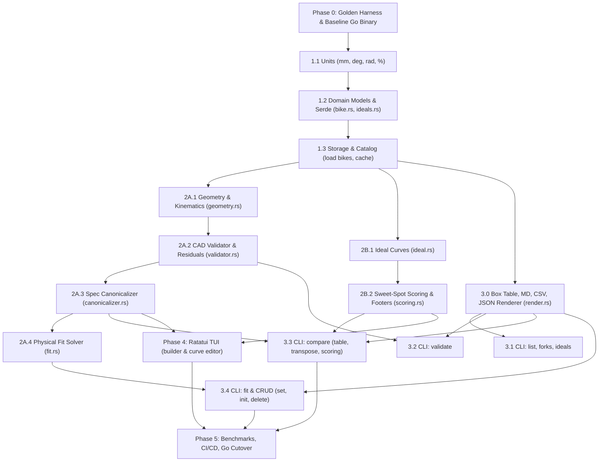

# Rust Migration Plan: Principled & Bug-Compatible Port

This document outlines the step-by-step strategy for migrating **BikeGeo** from Go to **Rust**. The overriding mandate is **strict behavioral and numerical bug-compatibility**, validated by differential testing (diffing CLI outputs, JSON payloads, and exit codes against the reference Go binary).

---

## 1. Guiding Principles & Objectives

1. **Strict Output Parity (Zero Diff Tolerance):**
   - The Rust binary must accept identical CLI flags and arguments, produce identical standard output (table, markdown, CSV, and JSON), output identical diagnostic/residual messages, and return identical exit codes (`0` on success, `1` on domain/validation failure, `2` on CLI usage/parse error).
2. **Ground Truth & Chart Immutability:**
   - Published manufacturer geometry numbers remain sacred. No tolerances, rounding residuals, or validation thresholds (`2.0 mm` precision floor, `1.0 mm` A2C slop trigger) may be nudged during the port.
3. **Type-Driven Domain Safety:**
   - Eliminate Go's primitive obsession and untyped structs by encoding physical invariants into Rust's type system:
     - Compile-time units of measure (`Millimeter`, `Degree`, `Radian`, `Percent`).
     - Exhaustive algebraic data types (sum types) for fork configurations (`Rigid` vs. `Suspension`) and headset cups (`Integrated` vs. `External`).
     - Make invalid states unrepresentable (e.g., non-zero sag on a rigid fork cannot compile).
4. **Differential Test-Driven Verification:**
   - No Go package is deprecated until its Rust equivalent passes all ported unit tests and the full differential CLI test harness with zero diff.

---

## 2. Dependency Architecture & Critical Path (DAG)

Analysis of the Go package hierarchy reveals that several subsystems can be developed in parallel, while others have strict topological dependencies:

1. **Storage & Catalog are foundational:** `validator`, `canonicalizer`, and `fit` all import `catalog`, and validation unit tests load real bike datasets from `data/bikes/*.json`. Storage and catalog must therefore be ported in Phase 1 alongside core models, not deferred to Phase 3.
2. **Geometry and Ideals are independent parallel tracks:** `geometry` (kinematics/trigonometry) and `ideal` + `scoring` (piecewise scoring curves) do not depend on each other. They can proceed in parallel once Phase 1 is in place.
3. **Canonicalizer strictly depends on Validator:** In addition to parsing specs, `canonicalizer` imports `validator` to verify fork compatibility and A2C constraints.
4. **Incremental CLI Differential Verification:** Rather than deferring all CLI commands to the end of the project, CLI commands can be verified against the Go reference binary in stages as each engine subsystem completes.



---

## 3. Work Breakdown & Gantt-Style Roadmap

The following schedule matrix maps prerequisites, deliverables, verification gates, and parallel tracks. Critical path items are marked with **[CP]**.

| Stage ID | Workstream / Component | Prerequisites | Parallel With | Verification Gate |
| :--- | :--- | :--- | :--- | :--- |
| **0.0 [CP]** | **Differential Test Harness & Golden Master** | None | - | `bin/bikegeo-go` built; 100+ commands recorded in golden fixtures. |
| **1.1 [CP]** | **Compile-Time Dimensional Units (`units.rs`)** | 0.0 | - | Unit tests for `Millimeter`, `Degree`, `Radian`, `Percent` conversions. |
| **1.2 [CP]** | **Domain Models & Serde Schema (`model/`)** | 1.1 | - | Round-trip Serde parity on all `data/bikes/*.json` and `data/ideals/*.json`. |
| **1.3 [CP]** | **Storage & Catalog Engine (`storage/`, `catalog/`)** | 1.2 | - | Ported `storage_test.rs`; loads all real frames without errors. |
| **2A.1 [CP]** | **Kinematics & Sag Projections (`geometry/`)** | 1.3 | 2B.1, 3.0 | Ported `geometry_test.rs`; exact math parity on Stack, Reach, Sag. |
| **2B.1** | **Ideal Evaluation Curves (`ideal/`)** | 1.2 | 2A.1, 3.0 | Ported `ideal_test.rs`; tests piecewise linear and penalty curves. |
| **2B.2** | **Multi-Criteria Scoring Engine (`scoring/`)** | 2B.1 | 2A.2, 2A.3 | Ported `scoring_test.rs`; verified scoring math, deciders, footer text. |
| **3.0** | **Exact Box-Table & Output Renderer (`render.rs`)** | 1.1 | 2A.1, 2B.1 | Golden diff test against Go `RenderBoxTable`, Markdown, CSV, JSON. |
| **2A.2 [CP]** | **CAD Validator & Residual Analysis (`validator/`)** | 2A.1, 1.3 | 2B.2 | Ported `validator_test.rs`; passes CAD A2C back-solve and 2.0 mm slop. |
| **3.1** | **CLI Staged Milestone 1: `list`, `forks`, `ideals`** | 1.3, 3.0 | 2A.2, 2B.2 | **Differential Test:** Zero diff against Go for `list`, `forks`, `ideals`. |
| **2A.3 [CP]** | **Spec Parsing & Constraint Enforcement (`canonicalizer/`)** | 2A.2, 1.3 | 2B.2 | Ported `canonicalizer_test.rs`; rejects invalid fork travels/sag on rigid. |
| **3.2** | **CLI Staged Milestone 2: `validate`** | 2A.2, 3.0 | 2A.3 | **Differential Test:** Zero diff for `bikegeo validate --all` and `--json`. |
| **2A.4** | **Automated Physical Solver & Sweeps (`fit/`)** | 2A.3 | 3.3 | Ported `fit_test.rs`; sweeps sag, travel, A2C, rakes, cup types. |
| **3.3 [CP]** | **CLI Staged Milestone 3: `compare` (Core Feature)** | 2A.3, 2B.2, 3.0 | 2A.4 | **Differential Test:** Zero diff for multi-column `compare`, transposed, scoring. |
| **3.4** | **CLI Staged Milestone 4: `fit` & CRUD Commands** | 2A.4, 3.0 | Phase 4 | **Differential Test:** Zero diff for `fit`, `set`, `init`, `delete`. |
| **4.0** | **Interactive TUI via Ratatui (`tui/`)** | 2A.3, 2B.2 | 3.4 | Automated terminal keystroke tests for `compare -i` and ideals editor. |
| **5.0 [CP]** | **Final Cutover, Benchmarking & Tooling** | 3.3, 3.4, 4.0 | - | Full differential suite passes 100%; CI migrated; Go code retired. |

---

## 4. Migration Protocol & Operational Contract

To guarantee orderly, reproducible, and verifiable progress throughout the port, all implementation activities must adhere strictly to the following protocol:

### 4.1 Branch Isolation
* **Dedicated Branch:** All porting activities must occur strictly on the `migrate` branch.
* **Baseline Preservation:** `main` remains untouched as the production reference baseline. No migration commits may land directly on `main`.
* **Branch Initialization:** Prior to implementing Phase 0, the branch is established via `git checkout -b migrate`.
* **Clean State Guarantee:** The Go reference binary (`bin/bikegeo-go`) is built once from the clean baseline and preserved for differential testing.

### 4.2 Incremental Micro-Commit Discipline
* **One Minimal but Meaningful Unit Per Step:**
  - Every step must accomplish exactly one focused, self-contained atomic deliverable from the Work Breakdown Matrix (Section 3).
  - Examples of atomic units:
    - Step 1.1: Implement `units.rs` (dimensional scalar newtypes, arithmetic operator overloading, and unit tests).
    - Step 1.2: Implement `model/bike.rs` (Serde data structures matching `data/bikes/*.json` schema + unit test).
    - Step 3.0: Port `render.rs` box table formatting + golden diff test.
  - **Anti-pattern:** Never batch multiple modules, subsystems, or unrelated refactors into a single step or commit.
* **Commit Immediately After Each Step:**
  - As soon as a minimal unit of work satisfies its verification gate, the agent must commit it to git on `migrate`.
  - Uncommitted multi-step code accumulation is strictly prohibited.
* **Mandatory Pre-Commit Verification Gate:**
  - Every commit on `migrate` must represent a clean, compilable, and passing state. Broken or failing commits are forbidden.
  - Required checks before creating a commit:
    1. `cargo check` (zero compiler errors or warnings).
    2. `cargo test <target>` (100% test pass rate for all ported modules).
    3. Differential check (for CLI stages: `diff -u` against `bin/bikegeo-go` produces 0 diff).
    4. Code formatting: `cargo fmt`.
* **Standardized Commit Format:**
  - Follow Conventional Commits: `<type>(<scope>): <concise summary>`
    - Types: `feat`, `test`, `fix`, `refactor`, `docs`, `chore`.
    - Scopes: `units`, `model`, `storage`, `catalog`, `geometry`, `validator`, `canonicalizer`, `ideal`, `scoring`, `fit`, `render`, `cli`, `tui`, `diff`.
  - The commit message body must explicitly detail:
    1. The minimal unit of work completed.
    2. Verification commands executed and test results.

### 4.3 Agent Operational Loop (SOP)
For each incremental step, the AI agent must strictly follow this 7-step cycle:
1. **Scope Selection:** Select the next unblocked item from the Dependency DAG (Section 2) and Roadmap Matrix (Section 3).
2. **Implementation:** Write the Rust code and its corresponding 1:1 ported unit tests in `src/` and `tests/`.
3. **Fast Verification:** Run `cargo check && cargo test <target>` and ensure 100% pass rate.
4. **Parity Check (If Applicable):** If the step implements or touches CLI output or JSON serialization, run the differential test against `bin/bikegeo-go` to confirm zero diff.
5. **Format:** Run `cargo fmt`.
6. **Commit:** Stage only the relevant files (`git add <files>`) and commit to `migrate` with a structured Conventional Commit message.
7. **Report:** Provide a brief summary of the completed step to the user and identify the next unblocked item.

### 4.4 Impasse & Rollback Strategy
* If a borrow-checker conflict or architectural friction is encountered:
  - Do not layer speculative patches or hacky workarounds over multiple tool calls.
  - Discard uncommitted experiments back to the last clean commit (`git restore .`) and re-evaluate the ownership architecture cleanly before proceeding.

---

## 5. Detailed Phase Specifications

### Phase 0: The Differential Verification Harness (Pre-Migration)

Before writing Rust code, freeze the reference Go binary and record golden outputs.

1. **Compile Reference Go Binary:**
   ```bash
   make build && cp bin/bikegeo bin/bikegeo-go
   ```
2. **Build Golden Fixture Corpus (`tests/diff_harness.py`):**
   Execute identical commands against both binaries and assert:
   - `status_code_go == status_code_rust`
   - `stdout_go == stdout_rust` (character-for-character, including whitespace and line endings)
   - `stderr_go == stderr_rust`
3. **Capture the Test Matrix:**
   - **List & Discovery:** `bikegeo list`, `bikegeo list --all-sizes`, `bikegeo list --format json`, `bikegeo forks`, `bikegeo ideals`, `bikegeo ideals show default`
   - **Validation:** `bikegeo validate --all`, `bikegeo validate binary-havok`, `bikegeo validate --format json`
   - **Comparisons:** `bikegeo compare havok@110mm@20% hayduke:S3@110mm@20% fenrir:L@rigid`, `--transpose`, `--score-detail`, `--no-score`, `--format md`, `--format csv`, `--format json`, increment/decrement (`+spec`, `-1`)
   - **Fit Solver:** `bikegeo fit binary-havok`, `bikegeo fit hayduke --try travel=120,sag=20`
   - **CRUD Operations:** `bikegeo init`, `bikegeo set`, `bikegeo delete`
   - **Error Paths:** Unsupported travel, rigid on suspension frame, sag on rigid fork, unknown command.

---

### Phase 1: Core Units, Domain Models, & Storage Engine

1. **Dimensional Safety Module (`src/units.rs`):**
   ```rust
   #[derive(Debug, Clone, Copy, PartialEq, PartialOrd, Serialize, Deserialize)]
   pub struct Millimeter(pub f64);

   #[derive(Debug, Clone, Copy, PartialEq, PartialOrd, Serialize, Deserialize)]
   pub struct Degree(pub f64);

   #[derive(Debug, Clone, Copy, PartialEq, PartialOrd, Serialize, Deserialize)]
   pub struct Radian(pub f64);

   #[derive(Debug, Clone, Copy, PartialEq, PartialOrd, Serialize, Deserialize)]
   pub struct Percent(pub f64);

   impl Degree {
       pub fn to_radians(self) -> Radian {
           Radian(self.0.to_radians())
       }
   }
   ```
2. **Algebraic Sum Types for Invariants (`src/model/bike.rs`):**
   ```rust
   #[derive(Debug, Clone, PartialEq, Serialize, Deserialize)]
   #[serde(tag = "type")]
   pub enum HeadsetCup {
       #[serde(rename = "IS")]
       Integrated { bearing_angle: f64 }, // 0.0mm cup stack
       #[serde(rename = "EC")]
       External { lower_cup_stack_mm: Millimeter, standard: String },
       #[serde(rename = "ZS")]
       ZeroStack { lower_cup_stack_mm: Millimeter, standard: String },
   }

   #[derive(Debug, Clone, PartialEq, Serialize, Deserialize)]
   pub enum ForkConfiguration {
       Rigid {
           axle_to_crown_mm: Millimeter,
           rake_mm: Millimeter,
       },
       Suspension {
           travel_mm: Millimeter,
           sag_percent: Percent,
           static_a2c_mm: Millimeter,
           rake_mm: Millimeter,
       },
   }
   ```
3. **Storage & Catalog Engine (`src/storage/`, `src/catalog/`):**
   - Port [`pkg/storage/storage.go`](file:///Users/matt/src/bikegeo/pkg/storage/storage.go) and [`pkg/catalog/catalog.go`](file:///Users/matt/src/bikegeo/pkg/catalog/catalog.go).
   - Ensure bit-for-bit deserialization and serialization compatibility with all files in `data/bikes/*.json` and `data/ideals/*.json`.
   - Verify by running ported `pkg/storage/storage_test.go`.

---

### Phase 2: Mathematical Engine & CAD Solver

#### Track 2A: Kinematics, CAD Reverse-Engineering & Solver
1. **Geometry Kinematics (`src/geometry/`):**
   - Port [`pkg/geometry/geometry.go`](file:///Users/matt/src/bikegeo/pkg/geometry/geometry.go):
     - `Stack = BB_Drop - Rake * cos(HTA) + (A2C + Spacer + HTL) * sin(HTA)`
     - `Reach = Front_Center * cos(asin((Stack - BB_Drop) / Front_Center)) ...`
     - Chainstay sag trigonometry and wheel center migration.
     - Trail and Mechanical Trail formulas.
   - Run ported [`pkg/geometry/geometry_test.go`](file:///Users/matt/src/bikegeo/pkg/geometry/geometry_test.go).
2. **CAD Validator & Residual Analysis (`src/validator/`):**
   - Port [`pkg/validator/validator.go`](file:///Users/matt/src/bikegeo/pkg/validator/validator.go) and [`residuals.go`](file:///Users/matt/src/bikegeo/pkg/validator/residuals.go):
     - Reverse Axle-to-Crown formula:
       `A2C_geo = (Stack - BB_Drop + Rake * cos(HTA)) / sin(HTA) - HTL - Cup_Stack`
     - Dynamic uncertainty propagation with strict `2.0 mm` physical precision floor.
     - Static vs. Sagged CAD detection.
   - Run ported [`pkg/validator/validator_test.go`](file:///Users/matt/src/bikegeo/pkg/validator/validator_test.go).
3. **Constraint Canonicalizer (`src/canonicalizer/`):**
   - Port [`pkg/canonicalizer/canonicalizer.go`](file:///Users/matt/src/bikegeo/pkg/canonicalizer/canonicalizer.go):
     - Spec grammar: `frame[@size][@fork][@sag%]`.
     - Strict rejection of unsupported travel, rigid forks on suspension-only frames, and non-zero sag on rigid setups.
   - Run ported [`pkg/canonicalizer/canonicalizer_test.go`](file:///Users/matt/src/bikegeo/pkg/canonicalizer/canonicalizer_test.go).
4. **Physical Fit Solver (`src/fit/`):**
   - Port [`pkg/fit/fit.go`](file:///Users/matt/src/bikegeo/pkg/fit/fit.go) parameter sweep:
     - Fork travels, standard sag points (`0%, 15%, 20%, 25%, 30%`), static A2C values, rakes (`44, 51, 55mm`), and headset spacers (`0, 10, 12mm`).
   - Run ported [`pkg/fit/fit_test.go`](file:///Users/matt/src/bikegeo/pkg/fit/fit_test.go).

#### Track 2B: Sweet-Spot Scoring & Ideals (Parallel with Track 2A)
1. **Ideal Profiles & Curves (`src/ideal/`):**
   - Port [`pkg/ideal/`](file:///Users/matt/src/bikegeo/pkg/ideal) piecewise linear/penalty evaluation curves (Ideal `✓` = 100, Acceptable `~` = 75-100, Outside `✗` = 0-75).
   - Port profile registry and loader.
2. **Scoring Engine (`src/scoring/`):**
   - Port [`pkg/scoring/scoring.go`](file:///Users/matt/src/bikegeo/pkg/scoring/scoring.go):
     - Multi-criteria sweet-spot scoring across setups.
     - Head-to-head score differentials and deciding factors.
     - Plain-English footer generators (`Biggest Losses vs. Ideal`).
   - Run ported [`pkg/scoring/scoring_test.go`](file:///Users/matt/src/bikegeo/pkg/scoring/scoring_test.go).

---

### Phase 3: Exact-Match Output Renderer & Staged CLI Verification

1. **Exact-Match Box-Table Renderer (`src/cli/render.rs`):**
   - Directly port Go's [`RenderBoxTable`](file:///Users/matt/src/bikegeo/pkg/cli/render.go#L169-L254) line-for-line to guarantee character and padding parity:
     - Borders: `┌`, `┬`, `┐`, `─`, `├`, `┼`, `┤`, `│`, `└`, `┴`, `┘`.
     - Multi-line cell wrapping and 1-space cell padding.
   - Implement Markdown table formatter (`escape_markdown_cell`).
   - Implement CSV writer (via `csv` crate).
   - Implement JSON encoder with 2-space indentation.
2. **Staged CLI Verification (Incremental Differential Tests):**
   - **Stage 3.1:** Implement `list`, `forks`, and `ideals`. Verify zero diff against Go reference binary.
   - **Stage 3.2:** Implement `validate`. Verify zero diff for single frames and `--all`.
   - **Stage 3.3:** Implement `compare`. Verify zero diff across multi-column setups, transposed tables, score breakdowns, and incremental `+spec` / `-col` state adjustments.
   - **Stage 3.4:** Implement `fit` and CRUD commands (`set`, `init`, `delete`).

---

### Phase 4: Interactive TUI Port (`ratatui`)

Replace the ~2,500 lines of custom low-level `tcell` widget code in [`pkg/tui/`](file:///Users/matt/src/bikegeo/pkg/tui) with modern `ratatui`.

1. **Architecture:**
   - Use `ratatui`'s immediate-mode rendering architecture:
     ```rust
     pub struct AppState {
         pub mode: Mode,
         pub catalog: Catalog,
         pub session: CompareSession,
         pub active_ideal: IdealProfile,
     }

     pub fn render(frame: &mut Frame, state: &mut AppState) { ... }
     ```
2. **Components to Port:**
   - **Guided Column Builder (`compare -i`):**
     - Frame selector, size selector, fork selector (constrained to `supported_travel_mm`), sag selector.
   - **Ideals Profile Editor & Curve Inspector (`ideals edit <name>`):**
     - Parameter list, target range inputs, visual ASCII/Unicode curve graph showing Ideal/Acceptable/Outside inflection points.
3. **Verification:**
   - Port [`pkg/tui/ideals/ideals_tui_test.go`](file:///Users/matt/src/bikegeo/pkg/tui/ideals/ideals_tui_test.go) using `ratatui::backend::TestBackend` to simulate keystrokes and verify terminal screen buffers.

---

### Phase 5: Cutover, CI/CD, & Documentation

1. **Benchmarking & Performance:**
   - Measure performance gains on `bikegeo validate --all` and `bikegeo fit <frame>`.
   - Ensure binary size is optimized (`cargo build --release`, strip debug symbols).
2. **Build Tooling & Makefile Updates:**
   - Replace Go targets in `Makefile` with Cargo targets:
     ```makefile
     .PHONY: all fmt check test build clean

     all: check build

     fmt:
     	cargo fmt

     check:
     	cargo fmt --check
     	cargo clippy -- -D warnings
     	cargo test

     build:
     	cargo build --release
     	mkdir -p bin && cp target/release/bikegeo bin/bikegeo

     test:
     	cargo test -- --nocapture
     ```
3. **Update Agent Instructions (`AGENTS.md`):**
   - Update fast-feedback loop from `go vet ./... && go test ./...` to `cargo check && cargo test`.
   - Update final verification loop to `cargo fmt --check && cargo clippy && cargo test`.
4. **Deprecate Go Files:**
   - Remove `cmd/` and `pkg/` directories once the differential suite passes completely and CI is green.

---

## 6. Differential Test Matrix Reference Checklist

Before marking the migration complete, every item below must pass diffing against `bin/bikegeo-go`:

- [ ] `bikegeo list` (default table)
- [ ] `bikegeo list --all-sizes`
- [ ] `bikegeo list --format json`
- [ ] `bikegeo list --format md`
- [ ] `bikegeo list --format csv`
- [ ] `bikegeo forks`
- [ ] `bikegeo ideals`
- [ ] `bikegeo ideals show default`
- [ ] `bikegeo compare` (replaying `data/last_compare.json`)
- [ ] `bikegeo compare <frame1> <frame2>` (standard comparison)
- [ ] `bikegeo compare <frame1> <frame2> <frame3> <frame4> <frame5>` (auto-transposition)
- [ ] `bikegeo compare --transpose`
- [ ] `bikegeo compare --no-score`
- [ ] `bikegeo compare --score-detail`
- [ ] `bikegeo compare --format md`
- [ ] `bikegeo compare --format json`
- [ ] `bikegeo compare --format csv`
- [ ] `bikegeo compare +<spec>` (incremental column add)
- [ ] `bikegeo compare -<col_index>` (incremental column delete)
- [ ] `bikegeo validate <frame>`
- [ ] `bikegeo validate --all`
- [ ] `bikegeo fit <frame>`
- [ ] `bikegeo fit <frame> --try travel=120,sag=20`
- [ ] Error: Unsupported travel size (Exit code 1)
- [ ] Error: Rigid on suspension-only frame (Exit code 1)
- [ ] Error: Sag specified on rigid fork (Exit code 1)
- [ ] Error: Unknown subcommand (Exit code 2)
- [ ] Interactive `bikegeo compare -i` session
- [ ] Interactive `bikegeo ideals edit default` session
