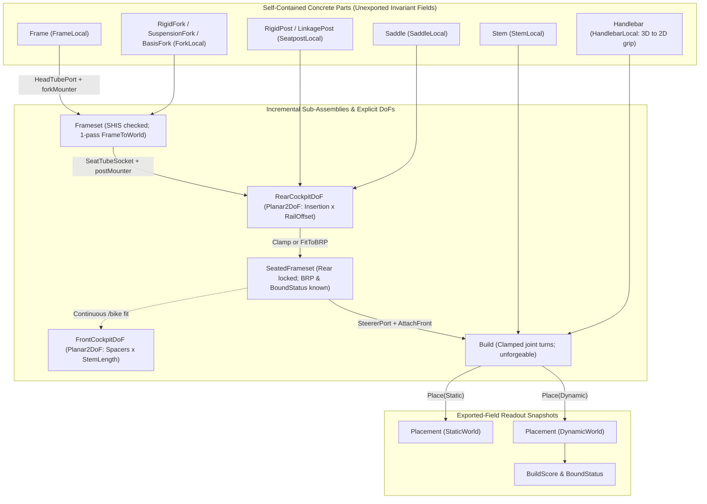

# Idiomatic Go Part-and-Mate Architecture Plan

## Goal Description

Refactor `bikegeo` so each bicycle component (`Frame`, `Fork`, `Seatpost`, `Saddle`, `Stem`, `Handlebar`) can be specified, designed, tested, and code-reviewed **in isolation**, and is guaranteed **by construction** to assemble accurately across the whole bike in both `Static` and `Dynamic` load states.

Today's codebase has three structural bottlenecks:
1. **Phantom generics fight Go idioms:** Slice 23 parameterized [pose.go](file:///Users/matt/src/bikegeo/internal/pose/pose.go) with phantom coordinate tags (`Point[S]`, `Vec[S]`, `Pose[Dir, W]`, `TurnDeg[FromDir, ToDir]`, `Transform[Src, Dst]`). Because Go methods cannot introduce new type parameters and Go interfaces cannot have generic methods, turtle chaining broke into nested `pose.Turn(...)` calls with single-use empty structs, `[W]` propagation stalled at `FramesetPlacement[W]` (leaving components hardcoded to `DynamicWorld`), and `pose.Transform` ended up with zero non-test callers.
2. **Flat `*Setup` structs blur part specs, mating ports, open degrees of freedom (DoFs), load states, and solver bounds:** `PlaceSeatpost` takes the whole `FrameSetup`; `StemSetup` holds headset upper stack, steerer spacer limits, and solver-only length bounds; `PlaceSaddle` and `PlaceHandlebar` apply world-level `Face` overrides that prevent unloading a clamped build to `StaticWorld`; SHIS headset rules are duplicated in three packages; `SeatpostInsertionBounds` is recomputed in six files; and `FitBuilds` bypasses `PlaceBike` using manual struct stitching and magic attribute array indices (`weighted(1)`, `weighted(7)`, `weighted(9)`).
3. **`DESIGN.md` is a chronological legislative log:** [DESIGN.md](file:///Users/matt/src/bikegeo/docs/DESIGN.md) accumulated 173 cross-amending `Q#` rulings, and Go comments cite `(Q67, Q77)` instead of stating physical rationale directly.

This plan resolves all three using idiomatic Go ([WRITE_CODE.md](file:///Users/matt/src/bikegeo/docs/WRITE_CODE.md)):
- **Concrete `pose` types + deterministic runtime `FrameID` assertions** (preserving compile-time `Point` vs. `Vec` separation while catching both world-space and datum-origin mismatches at runtime and restoring fluent turtle chaining).
- **Self-contained concrete part structs + thin consumer-side interfaces (1–2 methods)** defined at the point of use (`postMounter` in `seatpost.go`, `forkMounter` in `frameset.go`, `outliner` in `web/diagram.go`).
- **Option 3 encapsulation:** unexported fields on invariant-carrying domain objects (`Point`, `Pose`, `Transform`, part specs, `Frameset`, `SeatedFrameset`, `Build`) so invalid assemblies cannot be forged or mutated, paired with **exported fields on output/readout snapshots** (`Placement`, `BoundStatus`, `BuildScore`, `Fitting`) so `encoding/json`, templates, and tests need minimal glue.
- **Incremental monotonic assembly (`Frameset` → `SeatedFrameset` → `Build`)** with explicit `Planar2DoF` continuous solvers, `BoundStatus` auditability, clamped physical relative joint angles (unifying `Place(Static)` and `Place(Dynamic)`), and a modular present-tense `DESIGN.md` free of `Q#` citations.

> [!IMPORTANT]
> **Behavior-Preserving Refactoring Discipline:** While the new part and assembly types natively implement both `Static` and `Dynamic` load states (verified by unit tests on `LinkagePost`, `SuspensionFork`, and `Build.Place(Static)` vs. `Build.Place(Dynamic)`), `catalog`, `compare`, `/bike`, and CLI defaults preserve today's exact numerical outputs across all 7 stages. Intentional Milestone 6 model changes (switching catalog `redshift_shockstop_pro` from sagged-only `12 mm` to `7 mm` static + `(-6, +5) mm` sag, single travel-class sag, `+5°` SQlab rail angle, `coupledHbTarget`, and workshop warning UI) stay cleanly separated for follow-up slices once this architecture lands.

---

## Architecture Overview



---

## Execution Strategy (7 Atomic Stages)

Every stage below compiles cleanly and passes `make pre-commit` (`go fix`, `go fmt`, `go vet`, `make boundary`, `exhaustive`, `go test ./...`) so work can be reviewed commit-by-commit or part-by-part.

---

### Stage 1: Workflow & Modular Design Specification (`docs/`, `AGENTS.md`)

Retire permanent `Q#` numbering and reorganize the documentation so every component's design spec matches its Go file 1-to-1. Keep [WRITE_CODE.md](file:///Users/matt/src/bikegeo/docs/WRITE_CODE.md) as a permanent reference in the repo.

#### [MODIFY] [WORKFLOW.md](file:///Users/matt/src/bikegeo/docs/WORKFLOW.md)
- Keep the three Rolling-Wave horizons (Direction → 1-ahead `SLICE<n>.md` → Implementation & Diff Review) and model-tier routing.
- Replace `Q#` ruling rules: open questions use temporary `1, 2, 3` numbering inside the chat turn only; once decided, update the owning component or surface section of `DESIGN.md` **in place** in present tense and let `git log` hold history.
- Add review rule: code comments and docstrings must explain physical or engineering rationale in plain English and never cite `Q#` or `Slice #` identifiers.

#### [MODIFY] [AGENTS.md](file:///Users/matt/src/bikegeo/AGENTS.md)
- Update **Naming** and **Geometry & Technical Exposition** to reflect concrete `pose` types (`pose.FrameID`, `pose.Point`, `pose.Vec`, `pose.Pose`, `pose.Transform`) with runtime coordinate-frame checks rather than generic `Pose[Dir, W]` / `Vec[Dir]`.
- Add idiomatic Go interface guidance: accept thin (1–3 method) interfaces defined in the consumer file where component implementations genuinely differ; return concrete structs; use plain structs where behavior is uniform.
- Remove `Q#` citations from `AGENTS.md`, stating rules directly.

#### [MODIFY] [DESIGN.md](file:///Users/matt/src/bikegeo/docs/DESIGN.md)
- Rewrite as a concise, present-tense modular specification with zero historical `Q#` log:
  1. **Requirements & Package Boundaries**
  2. **Coordinate Frames, Affine Primitives, and `pose` Invariants** (`FrameID`, `Point` vs. `Vec`, `Pose` turtle chaining, `Transform` composition)
  3. **Component & Mate Specifications** (one subsection per file, reviewable in isolation):
     - *Frame & Headset* (`FrameLocal`, `HeadTubePort`, `SeatTubeSocket`, SHIS compatibility table, sliding dropouts)
     - *Fork* (`ForkLocal`, `RigidFork`, `SuspensionFork`, `BasisFork`, travel classes and sag)
     - *Seatpost* (`SeatpostLocal` from shaft bottom, `RigidPost`, `LinkagePost` static/dynamic cradle motion, socket insertion intersection)
     - *Saddle* (`SaddleLocal` at `RailCenter`, `BRP` and `SIT` landmarks, rail clamp offset bounds, clamped relative rail angle)
     - *Stem & Handlebar* (`SteererPort` upper stack and `30 mm` spacer cap, `StemLocal`, `HandlebarLocal` 3D-to-2D sagittal grip projection, clamped relative bar roll)
  4. **Incremental Assembly & Load States** (`Frameset` → `SeatedFrameset` → `Build`; single-pass axle leveling; unified `Place(Static)` and `Place(Dynamic)`)
  5. **Degrees of Freedom, Fitting, and `0–100` Scoring** (`BoundedRange`, `BoundStatus`, `Planar2DoF` solver objectives, 4-tier comparator, 12 attributes)
  6. **Web, CLI JSON, and Catalog Validation** (chart consistency in `catalog` tests, lossless `/` → `/bike` URLs)
  7. **Active Roadmap** (this architecture refactor, followed by Fit Audit Stage 2 Fenrir static check and Milestone 6 model slices).

---

### Stage 2: Replace Phantom Generics in `internal/pose` with Runtime `FrameID` Checks

Replace type parameters `[S]`, `[W]`, `[Dir, W]`, `[FromDir, ToDir]`, and `[Src, Dst]` with concrete structs carrying a registered `uint16` `FrameID`. Update existing callers mechanically with zero behavior change.

#### [MODIFY] [pose.go](file:///Users/matt/src/bikegeo/internal/pose/pose.go)
- **Coordinate Frame Identity (`FrameID`):**
  ```go
  // FrameID identifies a specific 2D coordinate frame (both its datum origin and
  // its +X/+Y axes). The zero value is invalid; register frames via NewFrame.
  type FrameID struct{ id uint16 }

  func NewFrame(name string) FrameID // allocates a unique non-zero id and records name
  func (f FrameID) String() string
  func (f FrameID) Valid() bool
  ```
  *Why `uint16` via `NewFrame`:* Two frames never collide by string spelling; `f1 == f2` is one integer instruction; and **any uninitialized zero-value `Point{}`, `Vec{}`, `Heading{}`, `Pose{}`, or `Transform{}` has `id == 0` and fails immediately on first use** (`pose: uninitialized zero-value FrameID`).
- **Affine & Angle Types (concrete, unexported fields):**
  - `Deg float64` (unchanged scalar angle for catalog specs and relative turn amounts).
  - `Heading struct { deg Deg; frame FrameID }` — constructed via `NewHeading(frame FrameID, deg Deg) Heading`; `Frame() FrameID`, `Deg() Deg`, `Turn(delta Deg) Heading`, `Sub(other Heading) Deg` (panics if `frame != other.frame` or invalid).
  - `Point struct { x, y float64; frame FrameID }` — constructed via `Pt(frame FrameID, x, y float64) Point` and `Origin(frame FrameID) Point`; `X() float64`, `Y() float64`, `Frame() FrameID`, `Sub(q Point) Vec`, `Add(v Vec) Point`, `OffsetTo(other Point) Vec`, `DistanceTo(other Point) float64`, `VerticalOffsetTo(other Point) float64`, `AngleTo(other Point) Heading`. Implements `MarshalJSON` emitting `{"X": p.x, "Y": p.y}`.
  - `Vec struct { x, y float64; frame FrameID }` — constructed via `Vc(frame FrameID, x, y float64) Vec`; `X() float64`, `Y() float64`, `Frame() FrameID`, `Add(w Vec) Vec`, `Sub(w Vec) Vec`, `Scale(k float64) Vec`, `Neg() Vec`, `Norm() float64`.
- **Fluent Turtle `Pose` & Rigid `Transform`:**
  - `Pose struct { origin Point; heading Heading }` — constructed via `NewPose(origin Point, headingDeg Deg) Pose` or `OriginPose(frame FrameID) Pose`:
    - `Origin() Point`, `Heading() Heading`, `HeadingDeg() Deg`, `Frame() FrameID`
    - `Advance(distMm float64) Pose`
    - `TranslateLocal(dx, dy float64) Pose` (moves `dx` along `p`'s local `+X` and `dy` along `p`'s local `+Y` while staying in `p.Frame()`)
    - `Turn(delta Deg) Pose` (fluent method chaining restored!)
    - `Face(worldHeading Heading) Pose` (asserts `p.Frame() == worldHeading.Frame()`)
    - `Anchor(childFrame FrameID) Transform` — returns `Transform` mapping `childFrame` (whose `(0, 0)` sits at `p.Origin()` and `+X` points along `p.Heading()`) into `p.Frame()`.
    - `MarshalJSON` emitting `{"Origin": p.origin, "HeadingDeg": p.heading.Deg()}`.
  - `Transform struct { src, dst FrameID; tx, ty, cos, sin float64 }`:
    - `NewTransform(src, dst FrameID, originInDst Point, headingInDst Deg) Transform` (asserts `originInDst.Frame() == dst`, `src.Valid()`, `src != dst`)
    - `IdentityTransform(frame FrameID) Transform`
    - `Src() FrameID`, `Dst() FrameID`
    - `ApplyPoint(p Point) Point` (asserts `p.Frame() == t.src`, returns `Point` in `t.dst`)
    - `ApplyVec(v Vec) Vec` (asserts `v.Frame() == t.src`, returns `Vec` in `t.dst`)
    - `ApplyPose(p Pose) Pose` (asserts `p.Frame() == t.src`, returns `Pose` in `t.dst`)
    - `OriginInDst() Point`, `HeadingInDst() Heading` (`PoseInDst() Pose`)
    - `Inverse() Transform` (`t.dst → t.src`)
    - `Compose(ab, bc Transform) Transform` (asserts `ab.dst == bc.src`, returns `ab.src → bc.dst`).

#### [MODIFY] [primitives.go](file:///Users/matt/src/bikegeo/internal/pose/primitives.go) & [pose_test.go](file:///Users/matt/src/bikegeo/internal/pose/pose_test.go)
- Update `Along(heading Heading, lengthMm float64) Vec`, `ProjectOnto(v Vec, heading Heading) float64`, and `DecomposeAlong(v Vec, headingA, headingB Heading) (a, b float64, ok bool)` to assert matching `FrameID`s.
- Add unit tests verifying deterministic panics on: (a) uninitialized zero-value `Point`/`Vec`/`Transform`, (b) cross-frame `Point.Sub` / `Point.Add`, (c) mismatched `Compose(ab, bc)`, and (d) origin-distinct frames (`RailClamp` vs. `SaddleLocal`).

#### [MODIFY] Mechanical Caller Updates (`internal/assembly`, `internal/catalog`, `internal/query`, `internal/web`, `cmd/bikegeo/main_test.go`)
- Replace `[DynamicWorld]`, `[UnpitchedChart]`, and `*Dir` type brackets with `assembly.DynamicWorld` and `assembly.UnpitchedChart` `FrameID` values; replace `.X` / `.Y` field reads on `pose.Point` and `pose.Vec` with `.X()` / `.Y()`; update `main_test.go`'s `jsonPose.Origin` to `struct{ X, Y float64 }`.

---

### Stage 3: `LoadState`, `BoundedRange` / `BoundStatus`, and Isolated `Seatpost`

Introduce shared load-state and bound-tracking primitives, then rewrite [seatpost.go](file:///Users/matt/src/bikegeo/internal/assembly/seatpost.go) so it has **zero dependency on `FrameSetup` or `DynamicWorld`**.

#### [NEW] [state.go](file:///Users/matt/src/bikegeo/internal/assembly/state.go)
- Define `LoadState` (`Static`, `Dynamic` — covered by `exhaustive` switches) and canonical world `FrameID`s (`UnpitchedChart`, `StaticWorld`, `DynamicWorld`).

#### [NEW] [bounds.go](file:///Users/matt/src/bikegeo/internal/assembly/bounds.go)
- `BoundedRange` (unexported fields `min, max float64; minSource, maxSource string`):
  - `NewBoundedRange(min, max float64, minSource, maxSource string) (BoundedRange, error)`
  - `IntersectRanges(a, b BoundedRange) (BoundedRange, bool)` (picks the tighter bound and preserves its `Source` label, e.g. `"seatpost min insertion"` vs. `"frame max insertion"`)
  - `Min() float64`, `Max() float64`, `Midpoint() float64`, `Clamp(v float64) float64`
  - `Bind(field InputField, v float64) (BoundStatus, error)` — returns `*InputError` if non-finite or outside `[min, max]`.
- `BoundStatus` (plain exported readout struct for JSON, templates, scoring, and warnings):
  ```go
  type BoundStatus struct {
      Field     InputField
      Value     float64
      Min       float64
      Max       float64
      MinSource string
      MaxSource string
  }
  func (b BoundStatus) MarginMm() float64          // min(Value - Min, Max - Value)
  func (b BoundStatus) WithinMargin(mm float64) bool
  func (b BoundStatus) AtMin(tol float64) bool
  func (b BoundStatus) AtMax(tol float64) bool
  ```

#### [MODIFY] [seatpost.go](file:///Users/matt/src/bikegeo/internal/assembly/seatpost.go) & [seatpost_test.go](file:///Users/matt/src/bikegeo/internal/assembly/seatpost_test.go)
- Coordinate frames:
  - `SeatpostLocal = pose.NewFrame("part:seatpost")` — `(0, 0)` at shaft bottom tip, `+X` up shaft centerline, `+Y` perpendicular rearward (`90°` CCW).
  - `SeatpostCradle = pose.NewFrame("part:seatpost_cradle")` — `(0, 0)` at rail-clamp pivot, `+X` parallel to shaft centerline.
- Ports:
  - `SeatTubeSocket struct { CollarInFrame pose.Transform; AllowedInsertion BoundedRange }` (`CollarInFrame` maps `SeatTubeCollar → FrameLocal`, with `(0, 0)` at `SeatTubeTop` and `+X` up the seat axis).
  - `RailClampPort struct { CradleInParent pose.Transform; ClampLengthMm float64 }`.
- Concrete seatpost types (unexported fields, validated constructors):
  - `RigidPost` (`NewRigidPost(totalLengthMm, minInsertionMm, maxInsertionMm, setbackMm, railClampLengthMm float64) (RigidPost, error)`): enforces `0 < min <= max < total`, `setback >= 0`, `clampLen > 0`; `RailClamp(state)` places `SeatpostCradle` at `(totalLengthMm, setbackMm)` for both `Static` and `Dynamic`.
  - `LinkagePost` (`NewLinkagePost(totalLengthMm, minInsertionMm, maxInsertionMm, staticSetbackMm, railClampLengthMm float64, sagStep pose.Vec) (LinkagePost, error)`): `RailClamp(Static)` places `SeatpostCradle` at `(totalLengthMm, staticSetbackMm)`; `RailClamp(Dynamic)` adds `sagStep` (e.g. `Vc(SeatpostLocal, -6, +5)`) with `0°` rotation.
- Consumer-side 2-method interface right next to `MateSeatpost`:
  ```go
  type postMounter interface {
      TotalLengthMm() float64
      InsertionLimits() BoundedRange
      RailClamp(state LoadState) RailClampPort
  }
  ```
  *(Or 2 methods if `ExposedMm` is derived from shaft-top landmark `(TotalLengthMm, 0)` in `RailClampPort` / `ShaftSpec()`; keep to 2–3 methods max.)*
- `MateSeatpost(socket SeatTubeSocket, post postMounter) (*SeatpostDoF, error)` → intersects `post.InsertionLimits()` with `socket.AllowedInsertion` immediately.
- `(*SeatpostDoF).Clamp(insertionMm float64) (*ClampedSeatpost, error)` → binds `insertionMm` into `BoundStatus`, computes `postInFrame = Compose(NewTransform(SeatpostLocal, SeatTubeCollar, Pt(SeatTubeCollar, -insertionMm, 0), 0), socket.CollarInFrame)`, and exposes `RailClampInFrame(state LoadState) RailClampPort` and `PlaceInWorld(frameToWorld pose.Transform, state LoadState) SeatpostPlacement`.
- Tests in `seatpost_test.go` verify `RigidPost`, `LinkagePost` static vs. dynamic cradle transforms (`(350, 7)` vs. `(344, 12)`), incompatible frame/post insertion rejection at `MateSeatpost` time, and `BoundStatus` margins — all without constructing a bicycle frame or world.

---

### Stage 4: Isolated `Saddle`, `Stem`, and `Handlebar`

Refactor [saddle.go](file:///Users/matt/src/bikegeo/internal/assembly/saddle.go), [stem.go](file:///Users/matt/src/bikegeo/internal/assembly/stem.go), and [handlebar.go](file:///Users/matt/src/bikegeo/internal/assembly/handlebar.go) into self-contained concrete parts in their own local coordinate frames, storing **clamped physical relative turns** rather than hardcoded `DynamicWorld` `Face` overrides.

#### [MODIFY] [saddle.go](file:///Users/matt/src/bikegeo/internal/assembly/saddle.go) & [saddle_test.go](file:///Users/matt/src/bikegeo/internal/assembly/saddle_test.go)
- `SaddleLocal = pose.NewFrame("part:saddle")` — `(0, 0)` at `RailCenter`, `+X` forward along rail toward nose, `+Y` perpendicular up.
- Concrete `Saddle` (`NewSaddle(dims SaddleDimensions) (Saddle, error)`, unexported fields): owns `BRP() pose.Point` (`(+RailCenterToBrpMm, +RailToBrpHeightMm)` in `SaddleLocal`), `SIT() pose.Point` (`(+RailCenterToSitBonesMm, +RailToBrpHeightMm + SitBonesElevationMm)` in `SaddleLocal`), and `RailLengthMm() float64`.
- `MateSaddle(clamp RailClampPort, saddle Saddle) (*SaddleDoF, error)`: validates `clamp.ClampLengthMm <= saddle.RailLengthMm()`, exposing `AllowedRailOffset() BoundedRange` (`±(railLength - clampLength)/2`).
- `(*SaddleDoF).Clamp(railOffsetMm float64, railTurnFromCradle pose.Deg) (*ClampedSaddle, error)`:
  - Stores `RailOffset BoundStatus` and `railTurnFromCradle pose.Deg` (the physical bolt angle relative to `SeatpostCradle`).
  - Provide helper `RailTurnForWorldPitch(cradleHeadingInWorld pose.Heading, worldPitchDeg pose.Deg) pose.Deg` so dynamic fitting computes `railTurnFromCradle` once when clamping, after which `ClampedSaddle.Place(cradleInWorld pose.Transform)` places `RailClamp`, `RailCenter`, `BRP`, and `SitBones` identically in `StaticWorld` and `DynamicWorld`!

#### [MODIFY] [handlebar.go](file:///Users/matt/src/bikegeo/internal/assembly/handlebar.go) & [handlebar_test.go](file:///Users/matt/src/bikegeo/internal/assembly/handlebar_test.go)
- `HandlebarLocal = pose.NewFrame("part:handlebar")` — `(0, 0)` at `BarClamp` center, `+X` forward at `0°` roll, `+Y` along rise/upsweep.
- Concrete `Handlebar` (`NewHandlebar(dims HandlebarDimensions) (Handlebar, error)`, unexported fields): validates 3D width/bend/sweep/inset and precomputes the 3D-to-2D sagittal projection `GripInBar() pose.Point` (in `HandlebarLocal`) and `HandLateralMm() float64`.
- `MountHandlebar(barClamp BarClampPort, bar Handlebar, rollTurnFromStem pose.Deg) ClampedHandlebar` (with helper `BarTurnForWorldRoll(stemHeadingInWorld pose.Heading, worldBarRollDeg pose.Deg) pose.Deg`).

#### [MODIFY] [stem.go](file:///Users/matt/src/bikegeo/internal/assembly/stem.go) & [stem_test.go](file:///Users/matt/src/bikegeo/internal/assembly/stem_test.go)
- Move `UpperStackMm` and `MaxSpacersMm` onto `SteererPort struct { HeadTubeTopInFrame pose.Pose; UpperStackMm float64; AllowedSpacers BoundedRange }` (resolving the existing `TODO` on `StemSetup`).
- Concrete `Stem` (`NewStem(clampHeightMm, lengthMm float64, angleDeg pose.Deg) (Stem, error)`, unexported fields): pure physical stem dimensions (no solver `MinLengthMm`/`MaxLengthMm` fields).
- `MountStem(steerer SteererPort, spacersMm float64, stem Stem) (*ClampedStem, error)` → binds `Spacers BoundStatus`, computes `CoverTop`, `SpacerTop`, `SteererClamp`, and `BarClampPort` in `FrameLocal`.

---

### Stage 5: `Frame`, Concrete `Fork` Types, and Single-Pass `Frameset`

Split bare frame, forks, and SHIS mating cleanly so `BasisFork`, `RigidFork`, and `SuspensionFork` are small concrete structs consumed through a 2-method `forkMounter` interface, and `Frameset` levels into any `LoadState` in one pass.

#### [NEW] [frame.go](file:///Users/matt/src/bikegeo/internal/assembly/frame.go)
- `FrameLocal = pose.NewFrame("part:frame")` — `(0, 0)` at `BB`, `+X` chart reach, `+Y` chart stack.
- Concrete `Frame` (`NewFrame(dims FrameDimensions) (Frame, error)`, unexported fields):
  - Validates chart scalars, `ChainstayMm > |BbDropMm|`, `LowerBore`, and physical `DefaultLowerCup`.
  - Precomputes in `FrameLocal`:
    - `RearAxle() pose.Point`
    - `HeadTube() HeadTubePort` (`TopPose`, `BottomPose` in `FrameLocal`, `LowerBore`, `DefaultLowerCup`)
    - `SeatTube() SeatTubeSocket` (`CollarInFrame` at `SeatTubeTop`, `AllowedInsertion` resolving `MaxPostInsertionMm` or `SeatTubeLengthMm - 20 mm` fallback right here inside `Frame`).

#### [NEW] [fork.go](file:///Users/matt/src/bikegeo/internal/assembly/fork.go)
- `ForkLocal = pose.NewFrame("part:fork")` — `(0, 0)` at crown race seat, `+X` down steerer, `+Y` forward in rake direction.
- Canonical SHIS compatibility function `CheckSHIS(bore LowerBore, cup LowerCupSetup, steerer Steerer) error` (single source of truth across the entire repo).
- Three concrete fork types (unexported fields, validated constructors):
  1. `RigidFork` (`NewRigidFork(staticA2cMm, rakeMm float64, steerer PhysicalSteerer) (RigidFork, error)`): `CheckHeadset` enforces physical SHIS; `AxleInFork(_)` returns `Pt(ForkLocal, staticA2cMm, rakeMm)`.
  2. `SuspensionFork` (`NewSuspensionFork(staticA2cMm, rakeMm float64, travel SuspensionTravel, steerer PhysicalSteerer, sagPct float64) (SuspensionFork, error)`): `AxleInFork(Static)` uses `staticA2cMm`; `AxleInFork(Dynamic)` uses `staticA2cMm - travel.Mm()*(sagPct/100)`.
  3. `BasisFork` (`NewBasisFork(basisA2cMm, rakeMm float64) (BasisFork, error)`): `CheckHeadset` allows `LowerCupBareHeadTube` (0 mm) or any physical cup matching `bore`; `AxleInFork(_)` returns `Pt(ForkLocal, basisA2cMm, rakeMm)`.

#### [MODIFY] [frameset.go](file:///Users/matt/src/bikegeo/internal/assembly/frameset.go) & [frameset_test.go](file:///Users/matt/src/bikegeo/internal/assembly/frameset_test.go)
- Consumer-side 2-method interface right next to `MateFrameset`:
  ```go
  type forkMounter interface {
      CheckHeadset(bore LowerBore, cup LowerCupSetup) error
      AxleInFork(state LoadState) pose.Point
  }
  ```
- `MateFrameset(frame Frame, lowerCup LowerCupSetup, upperStackMm float64, fork forkMounter, wheels WheelSetup) (*Frameset, error)`:
  - Validates `fork.CheckHeadset(frame.LowerBore(), lowerCup)` and `wheels`.
  - Computes `frontAxleInFrame(state)` via `Compose(forkInFrame, ...)`.
  - **Single-pass world placement:**
    - `Unpitched() FramesetPlacement` — applies `NewTransform(FrameLocal, UnpitchedChart, Origin(UnpitchedChart), 0)`.
    - `Place(state LoadState) FramesetPlacement` — computes `pitch = -rearInFrame.AngleTo(frontInFrame(state)).Deg()`, builds `frameToWorld := NewTransform(FrameLocal, worldFrame(state), Origin(worldFrame(state)), pitch)` in **one pass**, transforms all frame/headset/fork landmarks, and drops plumb-down (`-90°`) wheel-ground contact points in `worldFrame(state)`.
  - Exposes `SeatTube() SeatTubeSocket` and `Steerer() SteererPort` (with `DefaultMaxSpacersMm = 30 mm`).

---

### Stage 6: Incremental Assemblies (`SeatedFrameset` → `Build`), `Planar2DoF` Solver, and Named Scoring

Eliminate dummy `BikeSetup` mutations, parallel `PlaceBike` bypasses, and magic attribute-slice indices.

#### [NEW] [dof.go](file:///Users/matt/src/bikegeo/internal/assembly/dof.go)
- Extract self-contained 2D bounded affine solver:
  ```go
  type LinearDoF struct {
      Field   InputField
      Heading pose.Heading // unit-step movement direction of the target landmark in World
      Range   BoundedRange // parameter bounds [Min, Max]; travel is measured from ProbeValue
      Probe   float64      // parameter value at Planar2DoF.Origin
      Sign    float64      // +1 if increasing parameter advances along Heading, -1 if opposite
  }

  type Planar2DoF struct {
      Origin pose.Point // landmark position when AxisA == AxisA.Probe and AxisB == AxisB.Probe
      AxisA  LinearDoF
      AxisB  LinearDoF
  }

  func SolvePlanar2DoF(sheet Planar2DoF, target pose.Point, priority FitPriority) (valA, valB float64, limited []InputField, ok bool)
  ```
  - Unit-test `SolvePlanar2DoF` directly across interior, edge, corner, unbounded (`+Inf`), parallel-axis, and BRP-gate-clipping cases without needing bicycle fixtures.

#### [MODIFY] [bike.go](file:///Users/matt/src/bikegeo/internal/assembly/bike.go)
- `OpenRearCockpit(frameset *Frameset, post postMounter, saddle Saddle, dynamicRailPitchDeg pose.Deg) (*RearCockpitDoF, error)`:
  - Calls `MateSeatpost` and `MateSaddle` immediately (failing fast if incompatible).
  - Exposes `Planar2DoF()` in `DynamicWorld` (computed directly from `frameset.Place(Dynamic)`'s `SeatTubeTop` heading and `dynamicRailPitchDeg` — no whole-bike `PlaceBike` probe!).
  - `Clamp(insertionMm, railOffsetMm float64) (*SeatedFrameset, error)` — computes `railTurnFromCradle` in `DynamicWorld` so dynamic rail pitch equals `dynamicRailPitchDeg`, locks both `ClampedSeatpost` and `ClampedSaddle`, and returns an unforgeable `*SeatedFrameset`.
  - `FitToBRP(target pose.Point) (*SeatedFrameset, []InputField, error)` — solves `Planar2DoF` with `PriorityBRPGate` and calls `Clamp`.
- `(*SeatedFrameset).AttachFront(spacersMm float64, stem Stem, bar Handlebar, dynamicBarRollDeg pose.Deg) (*Build, error)`:
  - Calls `MountStem` and `MountHandlebar` (computing `rollTurnFromStem` in `DynamicWorld`), returning an unforgeable `*Build`.
- `(*Build).Place(state LoadState) Placement`:
  - Runs the **exact same forward transform composition** for `Static` and `Dynamic`:
    1. `fsPlaced := b.frameset.Place(state)` (`frameToWorld`)
    2. `postPlaced := b.seatpost.Place(frameToWorld, state)` (`cradleInWorld` includes `sagStep` only when `state == Dynamic`)
    3. `saddlePlaced := b.saddle.Place(postPlaced.CradleInWorld)` (uses locked `railTurnFromCradle`!)
    4. `stemPlaced := b.stem.Place(frameToWorld)`
    5. `barPlaced := b.handlebar.Place(stemPlaced.BarClampInWorld)` (uses locked `rollTurnFromStem`!)
  - Returns `Placement` (plain **exported-field** readout struct carrying `State LoadState`, `Frameset`, `Seatpost`, `Saddle`, `Stem`, `Handlebar`, `Bounds BuildBounds`, and `Summary BuildSummary` for lossless JSON/template access).
- Add dedicated `build_states_test.go` proving:
  1. On a `Build` with `SuspensionFork` (20% sag) + `LinkagePost` (`(-6, +5)` sag), `Place(Dynamic)` places rails at exact `dynamicRailPitchDeg` and bar at `-dynamicBarRollDeg`.
  2. Calling `Place(Static)` on that **exact same `*Build`** unloads the post by `(+6, -5)` in shaft coordinates and rotates all frame-clamped landmarks about `BB` by `pitch_static - pitch_dynamic` to `< 1e-12 mm`!

#### [MODIFY] [fitting.go](file:///Users/matt/src/bikegeo/internal/assembly/fitting.go), [build_fitting.go](file:///Users/matt/src/bikegeo/internal/assembly/build_fitting.go), & [scoring.go](file:///Users/matt/src/bikegeo/internal/assembly/scoring.go)
- `OpenFrontCockpit(seated *SeatedFrameset, stemAngleDeg pose.Deg, stemClampHeightMm float64, stemLenRange BoundedRange, bar Handlebar, dynamicBarRollDeg pose.Deg) (*FrontCockpitDoF, error)` → solves continuous `(SpacersMm, StemLengthMm)` via `SolvePlanar2DoF` for `/bike`'s continuous fitting readout.
- `FitPostSetback` → uses `SolvePlanar2DoF` on the `(InsertionMm, SetbackMm)` sheet directly.
- Replace `forkScoreBase`'s magic array index lookups (`weighted(1)`, `weighted(7)`, `weighted(9)`) in [scoring.go](file:///Users/matt/src/bikegeo/internal/assembly/scoring.go#L283-L307) with explicit named score methods evaluated on `*SeatedFrameset` (`scoreSeatedFrameset`), and have `FitBuilds` iterate `(spacers, stemOption, bar)` via `seated.AttachFront(...)` directly.

---

### Stage 7: Migrate `catalog`, `compare`, `query`, `web`, and `cmd/bikegeo` + Clean Up `Q#` Comments

Wire all outer packages cleanly onto the new domain types and delete obsolete `*Setup` glue.

#### [MODIFY] `internal/catalog` ([frame.go](file:///Users/matt/src/bikegeo/internal/catalog/frame.go), [forks.go](file:///Users/matt/src/bikegeo/internal/catalog/forks.go), [seatposts.go](file:///Users/matt/src/bikegeo/internal/catalog/seatposts.go), [saddle.go](file:///Users/matt/src/bikegeo/internal/catalog/saddle.go), [handlebars.go](file:///Users/matt/src/bikegeo/internal/catalog/handlebars.go), [stems.go](file:///Users/matt/src/bikegeo/internal/catalog/stems.go), [chart_consistency_test.go](file:///Users/matt/src/bikegeo/internal/catalog/chart_consistency_test.go), [basis_search_test.go](file:///Users/matt/src/bikegeo/internal/catalog/basis_search_test.go))
- `catalog.FrameSize` holds `ChartDims assembly.FrameDimensions` (keeping `chart_consistency_test.go` column nudging simple and direct) and constructs validated `assembly.Frame` values via `NewFrame`.
- `catalog.ForkOption` constructs a concrete `assembly.RigidFork` or `assembly.SuspensionFork`; `Frame.BasisFork` is a concrete `assembly.BasisFork` (eliminating `SteererBasis` sentinel checks!).
- `catalog.Seatposts()` returns validated `RigidPost` / `LinkagePost` values (keeping `redshift_shockstop_pro` at `staticSetback: 12, sagStep: (0, 0)` in this behavior-preserving refactor so all existing numerical pins pass unchanged, ready for Milestone 6's `7 mm` + `(-6, +5)` switch).

#### [MODIFY] [compare.go](file:///Users/matt/src/bikegeo/internal/compare/compare.go)
- Accept physical forks only (`PhysicalFork` consumer interface in `compare.go`), deleting both the `SteererBasis` runtime guard and the duplicate `validateForkLowerCup` SHIS switch table (`MateFrameset` validates SHIS in one canonical place).
- Delete dummy `InsertionMm: bounds.EffectiveMinInsertionMm` (`// the saddle fit replaces it`) and dummy `StemSetup` fields from `compare.Request`.

#### [MODIFY] `internal/query` ([bike.go](file:///Users/matt/src/bikegeo/internal/query/bike.go), [compare.go](file:///Users/matt/src/bikegeo/internal/query/compare.go)) & `internal/web` ([bike_page.go](file:///Users/matt/src/bikegeo/internal/web/bike_page.go), [compare_page.go](file:///Users/matt/src/bikegeo/internal/web/compare_page.go), [diagram.go](file:///Users/matt/src/bikegeo/internal/web/diagram.go))
- `query.Bike` holds catalog-resolved parts + `BikeParams` (raw user form inputs so `400` error pages still echo invalid user numbers in `<input>` controls), and `b.Assemble() (*assembly.Build, error)` builds the validated `*assembly.Build` inside `Evaluate()`.
- `compare_page.go`'s `brpFitNote` and `bike_page.go`'s form bounds read `Placement.Bounds` (`BoundStatus`) and `RearCockpitDoF` directly instead of recomputing `SeatpostInsertionBounds` and `RailOffsetLimitMm`.
- `web/diagram.go` defines its own private `screenSpace = pose.NewFrame("web:screen")` and thin consumer helpers for drawing component outlines from `Placement`.
- Strip remaining `(Q...)` comment references across `cmd/` and `internal/`, keeping self-contained plain-English explanations.

---

## Verification Plan

### Automated Tests & Static Checks
After **every** stage (2 through 7):
```sh
make pre-commit
```
Which runs:
1. `go fix ./...` and `go fmt ./...`
2. `go vet ./...`
3. `make boundary` (std-lib-only binary check + banned terms check)
4. `go tool exhaustive ./...` (verifies every `LoadState`, `LowerBore`, `LowerCupStandard`, `ForkTravel`, `FitTier`, and `InputField` switch is exhaustive)
5. `go test -v ./...` (all unit, catalog chart-consistency, basis-search, solver, compare, query, browserless web HTML/SVG, and CLI JSON tests)

After Stage 7 completes, also run:
```sh
make deadcode
make bench
```
- `make deadcode` verifies zero unreachable functions from `main` or `-test` (confirming no leftover `*Setup` shims remain).
- `make bench` confirms `BenchmarkComparePage/selected_bar` stays on par with or faster than baseline (since single-pass `Frameset` leveling halves trig per frameset and `FrameID` is a `uint16` register compare).

### Isolated Per-Part Review Check
Verify the primary design goal directly:
- Read `internal/assembly/seatpost.go`, `saddle.go`, `stem.go`, `handlebar.go`, `frame.go`, and `fork.go` one file at a time: confirm each file defines its own `FrameID`, validates its own intrinsic invariants at construction, imports zero catalog/web code, and exposes only its mating port without knowing downstream bike assembly details.
