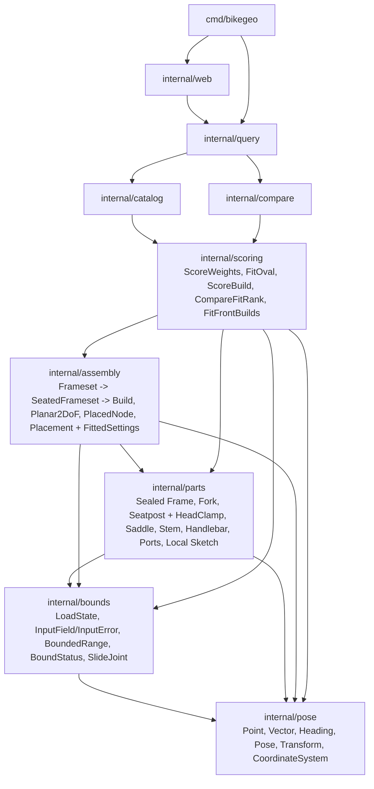

# Package-Sealed Delegation & `BikeSetup` Retirement Plan

Status: Planned 2026-11-27
Implementer: Stage 1: Medium · Stages 2–3: High (Frontier) · Stage 4: Medium · Stage 5: Low (mapped to Gemini, Claude, and Codex models in WORKFLOW.md §2 and per stage below)
Review: required — High / Frontier (Gemini 4 Carbon · Claude Opus 5.5 / Fable 5.2 · GPT-6.2 Astra)

## Goal Description

Finish decoupling `bikegeo` along genuine object and invariant boundaries while keeping typed outer bicycle stages (`Frameset` → `SeatedFrameset` → `Build`) and preserving all physical geometry math, catalog invariants, ranking results, and SVG visual outputs:

1. **Compiler-enforced sealing via a 4-package domain split (`bounds` → `parts` → `assembly` → `scoring`):** replace the single 16-file `internal/assembly` scope (where outer orchestrators can read private component fields or literal-construct `&Build{...}`) with strict package walls so private invariants are sealed by the Go compiler.
2. **Self-describing 1-DoF translational joints (`bounds.SlideJoint`):** let each sliding joint (`Insertion`, `RailOffset`, `Spacers`, continuous `StemLength`, hypothetical `Setback`) own its `BoundedRange` and local unit movement vector (`stepPerMm`) in its parent `CoordinateSystem`, eliminating manual `Sign: -1` / `Turn(180)` probe choreography in `RearCockpitDoF`, `FrontCockpitDoF`, and `FitPostSetback`.
3. **Physical hardware ownership & direct object delegation:**
   - Keep `Saddle` (`saddle.go`) a purely passive rigid part (`RailLengthMm`, `BRP`, `SIT`, rail/profile `Sketch`), while moving both saddle head tilt (`railTurnFromCradle`, orienting `RailClampLocal`) and fore-aft rail clamping (`RailSlideJoint` + tilted `30 mm` `SpanRailClamp` jaw sketch) onto the seatpost's rail-clamp head in `seatpost.go`.
   - Export minimal 3-method polymorphic part-family interfaces from `internal/parts` (`parts.Seatpost`, `parts.Fork` with physical `SagStatus`, `parts.PhysicalFork`), hold immutable value-type parts directly as collaborators (dropping `postSnapshot`/axle-copying defensive ceremony and pointer-mutation docstring claims), and delete duplicate caller interfaces and `forkMetadata`'s type-switch.
   - Keep `SeatedFrameset.AttachFront` in `internal/assembly` as the single canonical front-cockpit assembly path (retaining `dynStem` and `dynHandlebar` on `Build` so `scoring.FitFrontBuilds` evaluates candidates via `AttachFront` without duplicating part-mounting steps).
4. **Part-owned local millimeter `Sketch`es + uniform `PlacedNode` projection:** let each component/clamp describe its schematic spans and segments in its own local coordinate system (zero SVG/CSS concepts) so `web/diagram.go` projects `Placement.Nodes` through `NodeToWorld` without reaching into component scalar bags.
5. **Retire `Placement.Setup` (`setup_snapshot.go` / `BikeSetup`) and delete this plan on completion:** replace the 70-field `BikeSetup` shadow struct with a pure 11-field `FittedSettings` input mirror on `Placement.Settings` (moving placed measurements `EffectiveA2cMm`, `ForkRakeMm`, `WheelRadiusMm`, and `ExposedMm` onto `FramesetPlacement` and `SeatpostPlacement`), and delete `docs/implementation_plan.md` in Stage 5.

---

## Target Package Architecture



---

## Execution Strategy (5 Atomic Stages)

Every stage below must leave the repository compiling cleanly and passing `make pre-commit` (`go fix`, `go fmt`, `go vet`, `make boundary`, `exhaustive`, `go test ./...`).
- Do not introduce any banned terms (`chassis`, `cad`, `price`, `pricing`, `cost`, `cheap`, `ledger`) in code, filenames, or comments.
- If any temporary inter-stage snapshot helper is needed between Stage 2 and Stage 5 while `Placement.Setup` still exists, include the literal marker `TempSetupBridge` in its identifier so Stage 5 can audit and remove every occurrence cleanly.

---

### Stage 1: Extract `internal/bounds` & Self-Describing `SlideJoint`

Recommended Implementer: **Medium** (`Gemini 4 Neon` · `Claude Sonnet 5.5` · `GPT-6.2 Sol`) — package extraction of existing tested types plus implementing `SlideJoint` from explicit formulas and invariants below.

Create `internal/bounds` (importing only `internal/pose` and standard library) as the shared foundation for load states, attributed input errors, bounded intervals, and 1-DoF linear sliding joints.

#### [NEW] `internal/bounds/` (`state.go`, `input.go`, `range.go`, `joint.go`, `bounds_test.go`)
- **`LoadState` & ambient world coordinate systems (`state.go`):**
  - Move `LoadState` (`Static`, `Dynamic`), `UnpitchedChart`, `StaticWorld`, `DynamicWorld`, `LoadState.Valid()`, `LoadState.WorldSystem()`, and `LoadStateForWorld(pose.CoordinateSystem)` from `internal/assembly/state.go`.
- **Attributed validation errors (`input.go`):**
  - Move `InputField` (all 13 constants) and `*InputError` / `NewInputError` from `internal/assembly/validate.go` so `bounds`, `parts`, `assembly`, `scoring`, and `web` share one exhaustive error-attribution enum without import cycles.
- **Validated intervals & bound status (`range.go`):**
  - Move `BoundedRange`, `NewBoundedRange`, `IntersectRanges`, and `BoundStatus` (including `MarshalJSON`/`UnmarshalJSON`, `MarginMm`, `WithinMargin`, `AtMin`, `AtMax`) from `internal/assembly/bounds.go`.
- **1-DoF translational joint (`joint.go`):**
  - Define `SlideJoint` (unexported fields, zero value invalid):
    - Constructed via `NewSlideJoint(field InputField, allowed BoundedRange, originAtZero pose.Point, stepPerMm pose.Vector, turnDeg pose.Deg, childSystem pose.CoordinateSystem) SlideJoint`.
    - Asserts `allowed.Valid()`, `originAtZero.CoordinateSystem() == stepPerMm.CoordinateSystem()`, `childSystem.Valid()`, `childSystem != originAtZero.CoordinateSystem()`, and `|stepPerMm.Norm() - 1| <= 1e-9` (unit-length displacement vector in the parent `CoordinateSystem` per `+1 mm` of parameter increase).
    - `Field() InputField`, `Allowed() BoundedRange`, `StepPerMm() pose.Vector`, `ParentSystem() pose.CoordinateSystem`, `ChildSystem() pose.CoordinateSystem`.
    - `TransformAt(val float64) pose.Transform` (places `childSystem` at `originAtZero.Add(stepPerMm.Scale(val))` rotated by `turnDeg`, for internal probe placement).
    - `Bind(val float64) (pose.Transform, BoundStatus, error)` (validates `val` via `allowed.Bind(field, val)` and returns `TransformAt(val)` + `BoundStatus`).
- **Tests (`bounds_test.go`):**
  - Migrate existing `bounds_test.go` cases and add unit tests for `SlideJoint` (`Bind` in-range/out-of-range, `TransformAt` along `(-1, 0)` vs. `(+1, 0)` vs. rotated directions, and deterministic panics on zero-value `SlideJoint`, non-unit `stepPerMm`, or mismatched parent/child `CoordinateSystem`s).

#### [MODIFY] Caller Updates (`internal/assembly`, `internal/catalog`, `internal/compare`, `internal/query`, `internal/web`)
- Update references to `bounds.LoadState`, `bounds.Static` / `bounds.Dynamic`, `bounds.StaticWorld` / `bounds.DynamicWorld` / `bounds.UnpitchedChart`, `bounds.BoundedRange`, `bounds.BoundStatus`, `bounds.InputField`, and `*bounds.InputError` (keeping `exhaustive` switches green in `web/web.go` and `web/bike_page.go`).

---

### Stage 2: Extract Sealed `internal/parts` with Physical Head-Clamp Ownership, `SlideJoint`s, & Local `Sketch`es

Recommended Implementer: **High / Frontier** (`Gemini 4 Carbon` · `Claude Opus 5.5` / `Fable 5.2` · `GPT-6.2 Astra`) — reshapes the physical `Seatpost` head-clamp vs. passive `Saddle` boundary across coordinate systems (`SeatTubeCollar`, `RailClampLocal`, `SaddleLocal`) and establishes each part's local `Sketch` anchors.

Move all physical bicycle components and mating ports into `internal/parts` (importing only `internal/pose` and `internal/bounds`), sealing component internals away from `assembly`, `scoring`, `compare`, `query`, and `web`.

#### [NEW] `internal/parts/` (`spaces.go`, `sketch.go`, `frame.go`, `fork.go`, `seatpost.go`, `saddle.go`, `stem.go`, `handlebar.go`, `*_test.go`)
- **Local `CoordinateSystem`s (`spaces.go`):**
  - `FrameLocal`, `SteererLocal`, `LowerHeadsetLocal`, `ForkLocal`, `SeatTubeCollar`, `SeatpostLocal`, `SeatpostCradle`, `RailClampLocal`, `SaddleLocal`, `StemLocal`, `HandlebarLocal`.
- **Part-local millimeter visual geometry (`sketch.go`):**
  - Pure geometric primitives with zero SVG/color/pixel fields:
    - `SpanKind` enum (`SpanUpperCover`, `SpanSpacers`, `SpanSteererClamp`, `SpanStemBody`, `SpanRailClamp`, `SpanSaddleRail`) and `LocalSpan{Kind SpanKind; Axis pose.Pose; StartMm, LengthMm float64}`.
    - `SegmentKind` enum (`SegChainstay`, `SegSeatTube`, `SegSeatstay`, `SegHeadTube`, `SegLowerCup`, `SegForkSteerer`, `SegForkRake`, `SegSeatpostShaft`, `SegSeatpostSetback`, `SegSaddleProfile`, `SegHandlebarSweep`) and `LocalSegment{Kind SegmentKind; From, To pose.Point}`.
    - `Sketch{Spans []LocalSpan; Segments []LocalSegment}`.
- **Polymorphic part-family interfaces & direct collaborator delegation:**
  - `parts.Fork` (3 physical methods):
    ```go
    type Fork interface {
        CheckHeadset(bore LowerBore, cup LowerCupSetup) error
        AxleInFork(state bounds.LoadState) pose.Point
        SagStatus() (travel ForkTravel, sagPct float64, ok bool)
    }
    type PhysicalFork interface {
        Fork
        Steerer() PhysicalSteerer
    }
    ```
    (`SuspensionFork.SagStatus()` returns `(f.travel, f.sagPct, true)`; `RigidFork` and `BasisFork` return `(TravelRigid, 0, false)`.)
  - `parts.Seatpost` (3 physical methods):
    ```go
    type Seatpost interface {
        TotalLengthMm() float64
        InsertionLimits() bounds.BoundedRange
        RailClamp(state bounds.LoadState) RailClampPort
    }
    ```
  - Hold `parts.Seatpost` directly on `SeatpostDoF` / `ClampedSeatpost` (`Seatpost() parts.Seatpost`) and `parts.Fork` directly on `Frameset` (`Fork() parts.Fork`), deleting `postSnapshot` and removing the pointer-mutation docstring claims.
- **Physical `SlideJoint` & `Sketch` ownership per component:**
  - `Frame` (`frame.go`): owns `LocalSketch()` (`SegChainstay`, `SegSeatTube`, `SegSeatstay`, `SegHeadTube` in `FrameLocal`), `RearAxle()`, `SeatAxis()`, `HeadTube()`, and `SeatTube()`.
  - `Saddle` (`saddle.go`): purely passive rigid part in `SaddleLocal` owning `Dimensions()`, `RailLengthMm()`, `BRP()`, `SIT()`, and `LocalSketch()` (`SpanSaddleRail` centered at `(0, 0)` along `+X` in `SaddleLocal` and `SegSaddleProfile` from `SIT` to `BRP`) — zero tilt or clamp logic.
  - `Seatpost` & Head Clamp (`seatpost.go`):
    - **Shaft mate (`MateSeatpost` → `SeatpostDoF` → `ClampedSeatpost`):** exposes `InsertionJoint() bounds.SlideJoint` in `SeatTubeCollar` (`stepPerMm = NewVector(SeatTubeCollar, -1, 0)`), binds `InsertionMm`, and emits a collar-local `Sketch` containing only `SegSeatpostShaft` (`[0, ExposedMm]`) and `SegSeatpostSetback` (from `(ExposedMm, 0)` to the state's cradle origin in `SeatTubeCollar`).
    - **Head-clamp mate (`OpenRailClamp(clamp RailClampPort, saddle Saddle)` → `RailClampDoF` → `ClampedRailHead`):** validates `clamp.ClampLengthMm <= saddle.RailLengthMm()`, locks `railTurnFromCradle` (orienting `RailClampLocal` in `SeatpostCradle`, with helper `RailTurnForWorldPitch`), exposes `RailSlideJoint(railTurnFromCradle) bounds.SlideJoint` in `RailClampLocal` (`stepPerMm = NewVector(RailClampLocal, -1, 0)` over `[−limit, +limit]`), emits `RailClampLocal`'s `Sketch` (`SpanRailClamp` of length `ClampLengthMm` centered at `(0, 0)` along `+X`), and places both the tilted clamp jaws and the passive `Saddle` landmarks/sketch cleanly in separate coordinate systems (`RailClampLocal` and `SaddleLocal`).
  - `SteererPort`, `Stem`, & `ClampedStem` (`stem.go`):
    - `SteererPort` owns `SpacersJoint() bounds.SlideJoint` (`originAtZero = (UpperStackMm, 0)`, `stepPerMm = (+1, 0)` in `SteererLocal`) and `StemExtensionJoint(spacersMm, clampHeightMm float64, angleDeg pose.Deg, lengthRange bounds.BoundedRange) (bounds.SlideJoint, bounds.BoundStatus, error)`, sharing one internal clamp-center pose calculation (`UpperStackMm + spacersMm + clampHeightMm/2`, turned `−90° + angleDeg`) with `MountStem`.
    - `ClampedStem` emits its steerer-local `Sketch` (`SpanUpperCover` from `HeadTubeTop` `[0, UpperStackMm]`, `SpanSpacers` from `CoverTop` `[0, SpacersMm]`, `SpanSteererClamp` centered on `SteererClamp` `[−ClampHeightMm/2, +ClampHeightMm/2]`) and stem-local `Sketch` (`SpanStemBody` anchored at `StemLocal` `(0, 0)` with `StartMm = −LengthMm, LengthMm = LengthMm` so projected SVG `<rect>` attributes match today's `diagram.go` output).
  - `Handlebar` & `ClampedHandlebar` (`handlebar.go`): exposes `LocalSketch()` (`SegHandlebarSweep` from `(0, 0)` to `GripInBar()` in `HandlebarLocal`).
- **Tests (`internal/parts/*_test.go`):**
  - Move `seatpost_test.go`, `saddle_test.go`, `stem_test.go`, and `handlebar_test.go` into `internal/parts`, plus unit tests verifying `SteererPort.StemExtensionJoint` matches `MountStem` exactly (including `UpperStackMm`), head-clamp `RailClampLocal` vs. `SaddleLocal` sketches, `CheckSHIS`, and `Fork.SagStatus()`.

#### [MODIFY] `internal/assembly`, `internal/catalog`, `internal/compare`, `internal/query`, `internal/web`
- Delete duplicate `SeatpostPart` / `Seatpost` / `PhysicalFork` interfaces from `catalog/seatposts.go`, `catalog/forks.go`, `compare/compare.go`, and `assembly` in favor of `parts.Seatpost`, `parts.Fork`, and `parts.PhysicalFork`. Any short-lived snapshot helper needed while `Placement.Setup` remains uses the `TempSetupBridge` naming marker.

---

### Stage 3: Joint-Projected `Solve2DoF` & `PlacedNode` Sketch Projection

Recommended Implementer: **High / Frontier** (`Gemini 4 Carbon` · `Claude Opus 5.5` / `Fable 5.2` · `GPT-6.2 Astra`) — replaces signed `LinearDoF` probing across all three 2-DoF solvers (including unbounded `FitPostSetback`) and rewires `web/diagram.go`'s outline, segment, and close-up viewBox framing onto `PlacedNode`s while keeping SVG output unchanged.

Eliminate manual `Planar2DoF` probe/sign choreography and unexported-field scraping in `internal/assembly`, and switch `internal/web/diagram.go` to uniform `PlacedNode` sketch projection.

#### [MODIFY] `internal/assembly/dof.go`, `bike.go`, `frameset.go`, `fitting.go`
- **Direct `SlideJoint` → `LinearDoF` projection (`dof.go`):**
  - Add `ProjectSlideJoint(joint bounds.SlideJoint, probeVal float64, parentToWorld pose.Transform) LinearDoF`: rotates `joint.StepPerMm()` through `parentToWorld.ApplyVector(...)` into the target world so `Heading` points directly along `+1 mm` of parameter increase. Remove `LinearDoF.Sign` once all three callers use `ProjectSlideJoint` (`paramFromTravel(travel) = Range.Clamp(Probe + travel)`).
- **Simplify `RearCockpitDoF`, `FrontCockpitDoF`, and `FitPostSetback`:**
  - `RearCockpitDoF.Planar2DoF()` projects `postDoF.InsertionJoint()` (through `collarInWorld`) and `railClampDoF.RailSlideJoint(railTurn)` (through `railClampInWorld`) — zero `Sign: -1` or `Turn(180)` hand-wiring.
  - `FrontCockpitDoF.Planar2DoF()` projects `steerer.SpacersJoint()` and `steerer.StemExtensionJoint(...)` through `steererInWorld`.
  - Refactor `(*Build).FitPostSetback(brp pose.Point, railOffsetMm float64) (PostSetbackFitting, error)` to query public `Frameset` / `SeatedFrameset` / `Build` collaborators (`b.SeatedFrameset().Seatpost().Seatpost()`) and `ProjectSlideJoint`, returning `PostSetbackFitting{Fitting; SetbackMm float64}` with zero private-field access.
- **Retain `dynStem` / `dynHandlebar` on `Build` & populate `PlacedNode`s:**
  - Retain the already-computed `dynStem` and `dynHandlebar` placements inside `SeatedFrameset.AttachFront` (`Build.DynamicStem()`, `Build.DynamicHandlebar()`), and expose clean collaborator accessors (`Fork()`, `Seatpost()`, `Saddle()`, `DynamicRailPitchDeg()`, `Stem()`, `Handlebar()`, `DynamicBarRollDeg()`).
  - Define `PlacedNode{Transform pose.Transform; Sketch parts.Sketch}` in `internal/assembly` and populate `FramesetPlacement.Nodes` (`json:"-"`) and `Placement.Nodes` (`json:"-"`), giving each coordinate system (`FrameLocal`, `LowerHeadsetLocal`, `ForkLocal`, `SeatTubeCollar`, `RailClampLocal`, `SaddleLocal`, `SteererLocal`, `StemLocal`, `HandlebarLocal`) its own single-transform `PlacedNode`.
  - Add placed measurements `EffectiveA2cMm`, `ForkRakeMm`, and `WheelRadiusMm` to `FramesetPlacement`, and `ExposedMm` to `SeatpostPlacement`.

#### [MODIFY] `internal/web/diagram.go` & `diagram_test.go`
- Replace `stemOutlines(stem, bike.Setup.Stem)`, `seatParts` `bike.Setup.*` reads, and hardcoded segment lists in `buildBikeDiagram` with a thin consumer helper projecting `bike.Nodes` (`[]assembly.PlacedNode`), mapping `parts.SpanKind` and `parts.SegmentKind` to SVG names, thicknesses, stroke widths, colors, and close-up framing groups (`view=seat` vs. `view=stem`), and reading `bike.Frameset.WheelRadiusMm`.
- Verify all existing `diagram_test.go` and `web_test.go` SVG assertions pass unchanged, and add a unit test in `diagram_test.go` projecting isolated `RailClampLocal` + `SaddleLocal` `PlacedNode`s at a non-zero saddle pitch without constructing a `Build`.

---

### Stage 4: Extract `internal/scoring` Using Canonical `AttachFront`

Recommended Implementer: **Medium** (`Gemini 4 Neon` · `Claude Sonnet 5.5` · `GPT-6.2 Sol`) — package extraction of `scoring.go` and `build_fitting.go`, cross-package test-fixture migration, and straightforward delegation to `Build` and `SeatedFrameset.AttachFront`.

Move `0–100` rider-preference scoring and discrete front-cockpit search out of `internal/assembly` into `internal/scoring`, keeping `SeatedFrameset.AttachFront` as the single canonical front-cockpit assembly path.

#### [NEW] `internal/scoring/` (`scoring.go`, `build_fitting.go`, `scoring_test.go`, `build_fitting_test.go`, `build_fitting_reference_test.go`)
- Move `FitTier`, `AttributeName`, `AttributeScore`, `ScoreWeights`, `StemOption`, `BuildScore`, `FitOval`, `DefaultGripOval`, `CompareFitRank`, `ScoreBuild`, `ScoredBuild`, `CompareScoredBuilds`, `BuildRanking`, `FrontBuildOptions`, and `FitFrontBuilds` from `internal/assembly` to `internal/scoring` (importing `assembly`, `parts`, `bounds`, `pose`).
- **Delegate `ScoreBuild` directly to `*assembly.Build`:**
  - `ScoreBuild(build *assembly.Build, target assembly.FitTarget, stemScore float64, weights ScoreWeights) (BuildScore, error)` reads fork sag from `build.Fork().SagStatus()`, handlebar sweep from `build.Handlebar().Dimensions().BacksweepDeg`, spacers/rail/insertion from `build.Bounds()`, and handling geometry from `build.DynamicFrameset()` — **zero reads of `Placement.Setup`**.
- **Single canonical front-cockpit assembly in `FitFrontBuilds`:**
  - In `evalFrontOnSeated`, call `build, err := seated.AttachFront(spacers, st.part, bar.part, dynamicBarRollDeg)` directly (zero low-level `parts.MountStem` / `MountHandlebar` calls inside `scoring` and zero extra stage types), evaluate `gripR` from `build.DynamicHandlebar().HandGrip.Origin()`, and call `build.Place(bounds.Dynamic)` only on the `<= limit` kept winners.

#### [MODIFY] `internal/catalog`, `internal/compare`, `internal/query`, `internal/web`
- Update imports and type references (`scoring.ScoreWeights`, `scoring.StemOption`, `scoring.BuildScore`, `scoring.ScoredBuild`, `scoring.FitTier`, `scoring.AttributeScore`, `scoring.FitFrontBuilds`, `scoring.ScoreBuild`, `scoring.DefaultGripOval`).

---

### Stage 5: Retire `Placement.Setup` (`BikeSetup`), Verify Cleanliness, and Delete Plan

Recommended Implementer: **Low** (`Gemini 4 Hydrogen` · `Claude Haiku 5.5` · `GPT-6.1 Terra` / `GPT-6 Luna`) — compiler-guided removal of `Placement.Setup` in favor of the verbatim 11-field `FittedSettings` struct, `deadcode` / `TempSetupBridge` verification, roadmap cleanup, and deleting this plan file.

Delete `setup_snapshot.go`, `forkMetadata`, and any `TempSetupBridge` helpers; replace `Placement.Setup` with pure 11-field `FittedSettings`; and delete this plan file.

#### [DELETE] `internal/assembly/setup_snapshot.go`
- Delete `BikeSetup`, `FrameSetup`, `ForkSpec`, `ForkSetup`, `SeatpostSpec`, `SeatpostSetup`, `SaddleSetup`, `StemSetup`, and `HandlebarSetup`.
- Delete `forkMetadata`, `forkSetupSnapshot`, `frameSetupSnapshot`, and all `TempSetupBridge` helpers across `parts` and `assembly`.

#### [MODIFY] `internal/assembly/bike.go`, `internal/scoring/build_fitting.go`, `internal/query/`, `internal/web/`, `cmd/bikegeo/main_test.go`
- Add pure 11-field `FittedSettings` (installation inputs only, 1-to-1 with `query.BikeParams`) to `Placement.Settings`:
  ```go
  // FittedSettings records the 11 scalar installation inputs of a placed Build
  // for lossless /bike URL reconstruction and CLI JSON output.
  type FittedSettings struct {
      ForkA2cMm     float64
      LowerCupMm    float64
      SagPct        float64
      WheelRadiusMm float64
      PostInsertMm  float64
      RailOffsetMm  float64
      RailPitchDeg  pose.Deg
      SpacersMm     float64
      StemLengthMm  float64
      StemAngleDeg  pose.Deg
      BarRollDeg    pose.Deg
  }
  ```
- Update `scoring.CompareScoredBuilds` to read `Placement.Settings.{SpacersMm, StemLengthMm, StemAngleDeg}`.
- Update `query.paramsFromSettings(p.Settings)` in `query/bike.go` and `query/compare.go`.
- Update `web/web.go`, `web/bike_page.go` (reading `Seatpost.ExposedMm`, `Frameset.{EffectiveA2cMm, ForkRakeMm, WheelRadiusMm}`, `PostSetbackFitting`, and `opt.Fork.Travel.IsSuspension()` in `forkCellName`), and `web/compare_page.go` (`ChainstayMm: f.InstalledDims(sz).ChainstayMm`).
- Update `cmd/bikegeo/main_test.go` CLI JSON assertions from `Placement.Setup.Stem.*` / `Placement.Setup.Seatpost.InsertionMm` to `Placement.Settings.*`, keeping all numerical score/pose assertions identical.

#### [MODIFY] Docs & [DELETE] `docs/implementation_plan.md` (Final Step)
- Verify zero `TempSetupBridge` occurrences remain (`grep -rn TempSetupBridge cmd internal`), then run `make pre-commit` and `make deadcode`.
- Update `docs/DESIGN.md` (§7 Active Roadmap) and `docs/fit-audit/README.md` to remove the completed refactor item and mark **Fit Audit Stage 2 & Physical Fenrir Check** as the active next step.
- **Delete `docs/implementation_plan.md`** in the final commit of Stage 5.

---

## Verification Plan

After **every** stage (Stages 1 through 5):
```sh
make pre-commit
```
Which runs:
1. `go fix ./...` and `go fmt ./...`
2. `go vet ./...`
3. `make boundary` (standard-library-only binary check + banned-word checks)
4. `go tool exhaustive ./...` (all enum switches across `bounds`, `parts`, `assembly`, `scoring`, `web`)
5. `go test -v ./...`

In Stage 5 before the final commit:
```sh
make deadcode
```
Confirming zero unreachable functions in production or test packages and zero `TempSetupBridge` helpers remaining.
